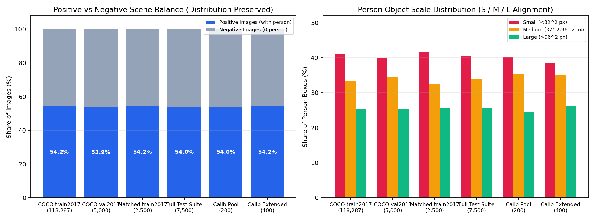

# Báo Cáo Chi Tiết 01: Thiết Kế Tập Kiểm Thử (7,500 Ảnh) & Tập Calibration Độc Lập (200 / 400 Ảnh) Bảo Toàn Phân Phối Dữ Liệu

## 1. Mục tiêu và Nguyên tắc Chọn Dữ liệu

Để đánh giá trung thực tác động trước và sau lượng tử hóa (`FP32` → `FP16` → `INT8 Dynamic` → `INT8 Static` và các biến thể tối ưu) trên mô hình **YOLO26n (416×416, `end2end=False`, pruned 1-class `person`)** mà **không làm biến dạng phân phối dữ liệu tự nhiên**, bộ dữ liệu cần thỏa mãn đồng thời 4 ràng buộc chặt chẽ:

1. **Khớp phân phối gốc của mô hình (Zero Distribution Shift):** YOLO26n được pretrain trên **COCO 2017** (bản phân phối thực tế của lớp `person`, tỉ lệ ảnh có người / không có người, tỉ lệ kích thước vật thể `Small < 32² px` / `Medium 32²–96² px` / `Large > 96² px`, mật độ người trên mỗi ảnh và ngữ cảnh nền đồng xuất hiện như `car`, `chair`, `bottle`, `cup`, `handbag`). Việc lọc thiên vị (ví dụ chỉ lấy ảnh đông người hoặc ảnh người to) sẽ làm méo ngưỡng kích hoạt `Entropy/Percentile` khi calibration và đánh sai `AP_small` khi benchmark.
2. **Độ lớn đủ tin cậy thống kê (7,500 ảnh Test):** Kết hợp toàn bộ **5,000 ảnh chính thức COCO `val2017`** cộng thêm **2,500 ảnh trích xuất phân tầng theo tỉ lệ thực từ COCO `train2017`** (`seed = 20261117`), tạo thành tập kiểm thử 7,500 ảnh với **16,190 bounding box `person` không-crowd**.
3. **Không dùng ảnh test để tinh chỉnh ngược — Zero Data Leakage:** Tập calibration (`Calib_200` lồng trong `Calib_400`) được rút hoàn toàn tách biệt từ phần **dư còn lại** của `train2017` sau khi đã rút `Test_SliceB_2500`. Kiểm tra bằng hàm băm nội dung **SHA-256** và **Image ID**: `0` ảnh trùng lặp (`SHA-256 overlap = 0`, `ID overlap = 0`).
4. **Đánh giá đầy đủ cả False Positive trên ảnh âm tính (Negative Backgrounds):** Bảo toàn ~`46%` ảnh không chứa nhãn `person` (người ngoài cảnh, đường phố xe cộ, nội thất ghế/bàn/tivi/chai lọ — các nhóm dễ gây báo động giả sau lượng tử hóa).

---

## 2. Phương pháp Phân Tầng Đồng Đều Theo Tỉ Lệ (Proportional Stratified Sampling)

Trong [scripts/prepare_datasets.py](../scripts/prepare_datasets.py) (tương ứng Cell 1 của [marimo/notebook.py](../marimo/notebook.py)), toàn bộ ảnh hợp lệ (`width >= 128`, `height >= 128`, loại bỏ ảnh âm tính chỉ gắn nhãn `iscrowd=1` gây mơ hồ) của `train2017` được gắn nhãn vào tổ hợp tầng 4 chiều:

$$\text{Stratum} = (\text{pos/neg}) \times (\text{count\_bin}) \times (\text{scale\_profile}) \times (\text{context})$$

Trong đó:
- **`pos/neg`**: Có hoặc không có annotation `category_id == 1` (`iscrowd == 0`).
- **`count_bin`**: Số người trong ảnh: `0`, `1`, `2_3` (2–3 người), `4_7` (4–7 người), `8p` ($\ge 8$ người).
- **`scale_profile`**: Dựa trên trung vị diện tích box người (`median_area`) theo chuẩn COCO (`S: < 1024 px²`, `M: 1024–9216 px²`, `L: >= 9216 px²`, hoặc `none` với ảnh negative).
- **`context`**: Ngữ cảnh đồng xuất hiện chính (`indoor`: `chair/dining table/couch/bed/tv/book`, `vehicle`: `bicycle/car/motorcycle/bus/truck`, hoặc `other`).

Sau khi trộn ngẫu nhiên theo `np.random.default_rng(20261117)` trong từng tầng, thuật toán **Hamilton / Largest-Remainder Allocation** phân bổ đúng tỉ lệ từng tầng cho:
1. **`Test_SliceB_2500`:** `2,500` ảnh `train2017` (ghép cùng `5,000` ảnh `val2017` thành `Test_Full_7500`).
2. **`Calib_400` & `Calib_200`:** Lấy từ **tập phần bù** (`train2017 \ Test_SliceB_2500`), đảm bảo `Calib_200` lồng khít bên trong `Calib_400` với phân bổ tỉ lệ đồng nhất.

---

## 3. Kiểm toán So khớp Phân phối Dữ liệu (Bảng Đo thực tế từ Marimo)

| Tập Dữ Liệu | Số Ảnh | Ảnh Có Người (`Pos %`) | Ảnh Nền Không Người (`Neg %`) | Số Box `person` | Small `<32²` | Medium `32²–96²` | Large `>96²` | TB Người / Ảnh Pos | Top Đối tượng Đồng Xuất Hiện (Tỉ lệ trên ảnh Pos) |
| :--- | :---: | :---: | :---: | :---: | :---: | :---: | :---: | :---: | :--- |
| **`COCO_train2017_natural`** (Gốc) | 118,287 | 54.2% | 45.8% | 257,253 | 41.0% | 33.5% | 25.5% | 4.01 | `car` (0.482), `chair` (0.433), `bottle` (0.210), `cup` (0.194) |
| **`COCO_val2017_natural`** (Gốc) | 5,000 | 53.9% | 46.1% | 10,777 | 40.0% | 34.5% | 25.5% | 4.00 | `chair` (0.503), `car` (0.473), `bottle` (0.228), `cup` (0.208) |
| **`Test_SliceB_2500_matched`** | 2,500 | 54.2% | 45.8% | 5,413 | 41.6% | 32.6% | 25.8% | 3.99 | `car` (0.502), `chair` (0.454), `bottle` (0.206), `cup` (0.195) |
| **`Test_Full_7500`** (**Tập Test Chung**) | **7,500** | **54.0%** | **46.0%** | **16,190** | **40.5%** | **33.9%** | **25.6%** | **4.00** | Khớp tự nhiên `val2017` + `matched_train2500` |
| **`Calib_200_matched`** (**Tập Calib Chính**) | **200** | **54.0%** | **46.0%** | **444** | **40.1%** | **35.4%** | **24.5%** | **4.11** | `chair` (0.528), `car` (0.398), `bottle` (0.361), `umbrella` (0.352) |
| **`Calib_400_matched`** (Mở rộng) | 400 | 54.2% | 45.8% | 885 | 38.6% | 35.0% | 26.3% | 4.08 | `chair` (0.571), `car` (0.300), `cup` (0.258), `bottle` (0.249) |

### Kết luận Kiểm toán Phân phối:
- Độ lệch tỉ lệ Positive/Negative giữa `Test_Full_7500` (`54.0% / 46.0%`), `Calib_200` (`54.0% / 46.0%`) so với toàn bộ `COCO_train2017` (`54.2% / 45.8%`) nhỏ hơn **0.2 điểm phần trăm**.
- Phân phối kích thước **Small / Medium / Large** của `Calib_200` (`40.1% / 35.4% / 24.5%`) bám sát phân phối mục tiêu `Test_Full_7500` (`40.5% / 33.9% / 25.6%`) và `COCO_val2017` (`40.0% / 34.5% / 25.5%`), đảm bảo khi thu thập dynamic-range histogram (nhất là tail Percentile 99.995%) ở **102 tầng Conv** không bị lệch sang người kích thước lớn hay bỏ quên tín hiệu yếu từ người kích thước nhỏ (`< 32² px`).
- Không tồn tại lỗi giải mã JPEG (`decode_errors = 0`), trùng Image ID (`0`), hay trùng SHA-256 nội dung (`0`) giữa `Test_Full_7500` và `Calib_400`/`Calib_200`. Toàn bộ danh sách ảnh chi tiết được lưu cố định trong [datasets/dataset_manifest.json](../datasets/dataset_manifest.json) và ảnh calibration gốc được lưu trực tiếp trong [calibration_data/](../calibration_data/).
