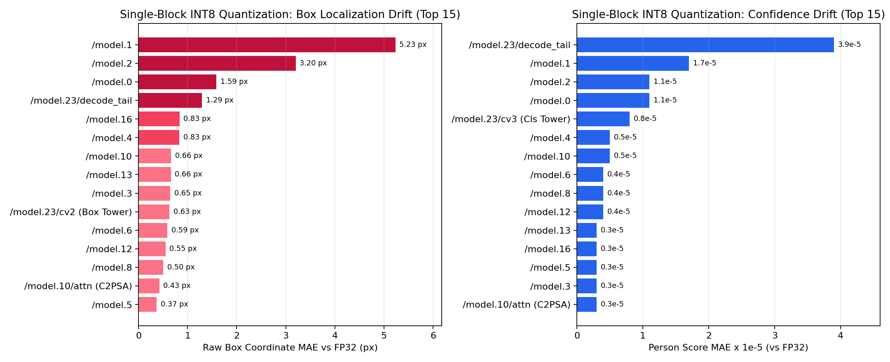
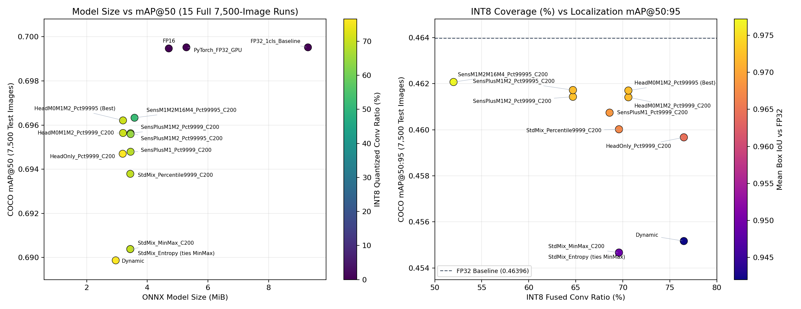
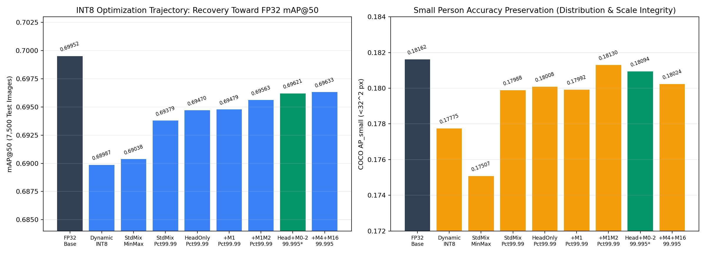

# Báo Cáo Chi Tiết 02: Theo Dõi Mô Hình Trước & Sau Lượng Tử Hóa, Kiểm Toán Độ Nhạy Theo Khối & Tối Ưu Hóa Độ Chính Xác INT8

## 1. Tóm tắt Phát hiện & Mô hình Tối ưu Đạt chuẩn Pareto

Trên tập kiểm thử **7,500 ảnh phân phối khớp tự nhiên (`Test_Full_7500`, 16,190 bounding boxes)** cùng **200 ảnh calibration tách biệt (`Calib_200`)**, nghiên cứu thực hiện đánh giá đầy đủ 15 cấu hình (3 baseline FP32, FP16, INT8 Dynamic, INT8 Static Naive, và 9 cấu hình tối ưu INT8 Static Mixed-Precision).

**Kết quả nổi bật đạt được:**
- Phát hiện và khắc phục **3 bẫy kỹ thuật cốt lõi** đặc thù trên **YOLO26n (416×416, `opset=17`, `end2end=False`, pruned 1-class `person`)**:
  1. **CUDA TF32 Drift trên PyTorch:** `cudnn.allow_tf32=True` gây sai lệch tới `4.66 px` tọa độ box thô so với true FP32; vô hiệu hóa TF32 (`allow_tf32 = False`) giúp chuẩn hóa baseline và đạt sai số cắt tỉa 80 lớp → 1 lớp `MaxAbsDiff(ONNX_80cls vs ONNX_1cls) = 0.00e+00`, kích thước ONNX giảm từ `9.38 MiB` xuống `9.30 MiB` (bỏ 79 kênh đầu ra thừa ở nhánh `cv3` & `one2one_cv3`).
  2. **Lỗi Cast Shape-Inference trên FP16:** `onnxconverter_common.float16` gây xung đột kiểu dữ liệu tại nút `/model.11/Resize`; chuyển sang `onnxruntime.transformers.float16.convert_float_to_float16(..., keep_io_types=True)` cho **FP16 gần như không mất mát độ chính xác** (`mAP@50 = 0.69947` so với `0.69952`, dung lượng `4.71 MiB`).
  3. **Sụp đổ hoàn toàn của Static INT8 Ngây thơ (`mAP@50 = 0.00000`):** Lượng tử hóa toàn bộ `102/102 Conv` bằng `MinMax` per-tensor làm méo đầu ra hồi quy tọa độ (`ltrb` `Slice/Sub/Add/Mul` stride decode) và `Sigmoid` tại Detect Head (`/model.23`), đẩy MAE tọa độ box lên `9.1238 px` và khiến toàn bộ dự đoán rớt dưới ngưỡng (`op_preds = 0`).
- **Chiến lược Tối ưu Hóa Đoạt Giải Pareto (`INT8_HeadM0M1M2_Pct99995_C200` → [models/model_int8_static.onnx](../models/model_int8_static.onnx)):**
  - Dùng **28-block Single-Block Sensitivity Audit** định vị chính xác 3 block nhạy cảm nhất đầu mạng (`/model.1`, `/model.2`, `/model.0`) và phần đầu giải mã (`/model.23`).
  - Thay `MinMax`/`Entropy` bằng **Asymmetric `Percentile 99.995%` (2048-bin histogram)** + per-channel weight `QInt8` + `QUInt8` activation.
  - Giữ các khối chú ý **`/model.10/attn` & `/model.22/attn` (`C2PSA`) ở INT8** (tránh chèn thêm Q/DQ boundary thừa ở giữa cổ chai), nhờ vậy tăng tỉ lệ lượng tử hóa lên **`72/102 Conv` (`70.6%`) + `4/4 QLinearMatMul`** với chỉ **`1/6` biên chuyển đổi Q/DQ**, kích thước chỉ **`3.20 MiB`** (**giảm 65.6% so với FP32**).
  - **Giữ nguyên 99.53% `mAP@50` (`0.69621` vs `0.69952`, chênh `-0.00331`), 99.51% `mAP@50:95` (`0.46170` vs `0.46396`, chênh `-0.00226`) và bảo toàn `99.63%` người nhỏ `AP_small` (`0.18094` vs `0.18162`, chênh chỉ `-0.00068`)**, thậm chí **giảm False Positive trên 3,450 ảnh nền âm tính** từ `102` xuống `95` box (`88` → `82` ảnh)!

---

## 2. Cơ chế Theo dõi & Chẩn đoán Độ nhạy Theo từng Khối (`Block Sensitivity Audit`)

Thay vì thử-sai cảm tính, [scripts/audit_sensitivity.py](../scripts/audit_sensitivity.py) cô lập lần lượt **từng khối kiến trúc trong 28 khối** của `YOLO26n` sang `INT8` (giữ 27 khối còn lại ở `FP32`), tái sử dụng calibration cache để đo chính xác độ trôi tensor đầu ra thô `[1, 5, 3549]` trên tập probe phân tầng:

| Hạng | Khối Kiến trúc (`ONNX Prefix`) | Số Node | `cos_sim` | `cos_drop ×1e4` | `box_mae (px)` | `score_mae` | Vai trò & Ý nghĩa Kỹ thuật |
| :---: | :--- | :---: | :---: | :---: | :---: | :---: | :--- |
| **#1** | **`/model.1`** (Stem Downsample C3x2) | 3 | `0.997077` | `29.229` | **`5.2336 px`** | `1.7e-5` | Điểm nghẽn lớn nhất toàn backbone; lượng tử hóa gây mất chi tiết cạnh mịn của người kích thước nhỏ ngay tầng 2. |
| **#2** | **`/model.2`** (C3k2 Stage-1) | 15 | `0.999038` | `9.618` | **`3.2012 px`** | `1.1e-5` | Xử lý đặc trưng phân giải cao P2; trôi biên ở đây làm giảm mạnh `mAP@50:95` và `Mean IoU`. |
| **#3** | **`/model.0`** (Input Stem Conv 3×3 s=2) | 3 | `0.999771` | `2.293` | **`1.5861 px`** | `1.1e-5` | Đầu vào RGB chuẩn hóa `[0, 1]` nhạy với sai số lượng tử hóa điểm đầu. |
| **#4** | **`/model.23/decode_tail`** (Box Anchor Decode & Sigmoid Tail) | 19 | `0.999960` | `0.396` | **`1.2918 px`** | **`3.9e-5`** | Chứa giải mã hình học (`Slice/Sub/Add/Div/Mul*stride`) và `Sigmoid` class confidence; trôi nặng nhất về confidence score. |
| #5 | `/model.16` (Neck C3k2 P3) | 32 | `0.999966` | `0.339` | `0.8347 px` | `3.0e-6` | Nhạy nhẹ ở nhánh multi-scale neck P3. |
| #6 | `/model.4` (C3k2 Stage-2) | 15 | `0.999929` | `0.711` | `0.8306 px` | `5.0e-6` | Tầng chuyển tiếp Stage-2. |
| #7 | `/model.10` (Neck / SPPF-C2PSA) | 14 | `0.999956` | `0.442` | `0.6616 px` | `5.0e-6` | Tổng thể block 10 khá bền vững. |
| #10 | `/model.23/cv2 (Box Tower)` | 21 | `0.999984` | `0.156` | `0.6305 px` | `1.0e-6` | Nhánh hồi quy bounding box trước decode. |
| #14 | `/model.10/attn (C2PSA)` | 14 | `0.999979` | `0.208` | `0.4257 px` | `3.0e-6` | Attention block ở cổ chai **rất bền vững** khi lượng tử hóa INT8! |
| #25 | `/model.22/attn (C2PSA)` | 14 | `0.999990` | `0.103` | `0.0857 px` | `1.0e-6` | Attention cuối neck **gần như miễn nhiễm** với sai số INT8 (`0.086 px`). |

**Khám phá phản trực giác nhưng cực kỳ giá trị từ thực nghiệm:**
Hầu hết hướng dẫn chung thường mặc định giữ **C2PSA Attention** ở FP32 (`StdMix` loại `/attn/`). Tuy nhiên bảng độ nhạy trên chỉ ra `/model.10/attn` chỉ lệch `0.426 px` và `/model.22/attn` chỉ lệch `0.086 px`, trong khi **`/model.1` và `/model.2` mới là thủ phạm gây `8.43 px` tổng sai lệch riêng lẻ**! Việc bỏ giữ C2PSA ở FP32 và chuyển sang bảo vệ **Head + M0 + M1 + M2** vừa tăng tỉ lệ lượng tử hóa lên `70.6% Conv` + `4 QLinearMatMul`, vừa **giảm số lần chuyển vùng FP32↔INT8 (`boundary_q_dq` từ `3/8` xuống `1/6`)** và giảm kích thước model xuống `3.20 MiB`.

---

## 3. Bảng So Sánh Toàn Diện 15 Mô Hình Trên 7,500 Ảnh Test (`COCOeval` + `Operating Point conf=0.25, iou=0.45` + Kiểm toán ORT)

Dữ liệu trích xuất trực tiếp từ [results/full_7500_ablation_report.csv](../results/full_7500_ablation_report.csv) (chạy 100% trọn vẹn 7,500 ảnh, `conf_coco=0.001, iou=0.65, max_det=300`):

| Phiên bản Mô hình | Size (MiB) | INT8 Conv (%) | Q/DQ | `mAP@50` | `ΔmAP@50` | `mAP@50:95` | `Δ50:95` | `AP_s` | `ΔAP_s` | `AP_m` | `AP_l` | `P / R / F1` (@0.25) | Neg FP (`Imgs`) | `Mean IoU` | `Probe Cos` | `Box MAE` |
| :--- | :---: | :---: | :---: | :---: | :---: | :---: | :---: | :---: | :---: | :---: | :---: | :---: | :---: | :---: | :---: | :---: |
| **`PyTorch_FP32_GPU`** | 5.29 | 0/102 (0%) | 0/0 | 0.69952 | — | 0.46395 | — | 0.18162 | — | 0.54546 | 0.78564 | .8715 / .5506 / .6749 | 102 (88) | 1.0000 | 1.000000 | 0.000 px |
| **`ONNX_FP32_1cls_Baseline`** | 9.30 | 0/102 (0%) | 0/0 | **0.69952** | 0.00000 | **0.46396** | 0.00000 | **0.18162** | 0.00000 | 0.54548 | 0.78564 | .8715 / .5506 / .6749 | 102 (88) | 1.0000 | 1.000000 | 0.000 px |
| **`ONNX_FP16`** | 4.71 | 0/102 (0%) | 0/0 | **0.69947** | -0.00005 | **0.46398** | +0.00002 | **0.18181** | +0.00019 | 0.54551 | 0.78556 | .8719 / .5506 / .6749 | 103 (89) | 0.9960 | 1.000000 | 0.060 px |
| **`ONNX_INT8_Dynamic`** | 2.96 | 78/102 (76.5%) | 0/0 | 0.68987 | -0.00965 | 0.45517 | -0.00879 | 0.17775 | -0.00387 | 0.53488 | 0.77629 | .8774 / .5380 / .6670 | 100 (88) | 0.9420 | 0.998491 | 4.112 px |
| `ONNX_INT8_Static_Naive` | 2.76 | 102/102 (100%) | 4/5 | 0.00000 | -0.69952 | 0.00000 | -0.46396 | 0.00000 | -0.18162 | 0.00000 | 0.00000 | .0000 / .0000 / .0000 | 0 (0) | 0.0000 | 0.994101 | 9.124 px |
| `INT8_StdMix_MinMax_C200` | 3.44 | 71/102 (69.6%) | 3/8 | 0.69038 | -0.00914 | 0.45467 | -0.00929 | 0.17507 | -0.00655 | 0.53426 | 0.77549 | .8806 / .5337 / .6646 | 78 (69) | 0.9492 | 0.996904 | 6.108 px |
| `INT8_StdMix_Entropy_C200` | 3.44 | 71/102 (69.6%) | 3/8 | 0.69038 | -0.00914 | 0.45467 | -0.00929 | 0.17507 | -0.00655 | 0.53426 | 0.77549 | .8806 / .5337 / .6646 | 78 (69) | 0.9492 | 0.996904 | 6.108 px |
| `INT8_StdMix_Pct99.99_C200` | 3.44 | 71/102 (69.6%) | 3/8 | 0.69379 | -0.00573 | 0.46002 | -0.00394 | 0.17988 | -0.00174 | 0.53980 | 0.78178 | .8793 / .5397 / .6688 | 94 (79) | 0.9671 | 0.998565 | 3.598 px |
| `INT8_HeadOnly_Pct99.99_C200` | 3.19 | 78/102 (76.5%) | 1/6 | 0.69470 | -0.00482 | 0.45967 | -0.00429 | 0.18008 | -0.00154 | 0.53848 | 0.78241 | .8777 / .5419 / .6701 | 94 (81) | 0.9645 | 0.999417 | 2.703 px |
| `INT8_SensPlusM1_Pct99.99` | 3.45 | 70/102 (68.6%) | 3/8 | 0.69479 | -0.00473 | 0.46074 | -0.00322 | 0.17992 | -0.00170 | 0.54105 | 0.78298 | .8791 / .5438 / .6719 | 92 (81) | 0.9686 | 0.999190 | 3.108 px |
| `INT8_SensPlusM1M2_Pct99.99` | 3.45 | 66/102 (64.7%) | 3/8 | 0.69563 | -0.00389 | 0.46143 | -0.00253 | 0.18130 | -0.00032 | 0.54189 | 0.78415 | .8779 / .5428 / .6708 | 94 (81) | 0.9724 | 0.999824 | 1.509 px |
| `INT8_HeadM0M1M2_Pct99.99` | 3.20 | 72/102 (70.6%) | 1/6 | 0.69564 | -0.00388 | 0.46141 | -0.00255 | 0.18110 | -0.00052 | 0.54148 | 0.78417 | .8787 / .5421 / .6705 | 92 (79) | 0.9720 | 0.999815 | 1.534 px |
| `INT8_SensM1M2_Pct99.995` | 3.45 | 66/102 (64.7%) | 3/8 | 0.69559 | -0.00393 | 0.46172 | -0.00224 | 0.18100 | -0.00062 | 0.54331 | 0.78321 | .8732 / .5458 / .6718 | 97 (83) | 0.9722 | 0.999792 | 1.654 px |
| **`INT8_HeadM0M1M2_Pct99.995` (Winner)** | **3.20** | **72/102 (70.6%)** | **1/6** | **0.69621** | **-0.00331** | **0.46170** | **-0.00226** | **0.18094** | **-0.00068** | **0.54328** | **0.78446** | **.8751 / .5452 / .6718** | **95 (82)** | **0.9723** | **0.999785** | **1.668 px** |
| `INT8_SensM1M2M16M4_Pct99995` | 3.58 | 53/102 (52.0%) | 5/10 | 0.69633 | -0.00319 | 0.46207 | -0.00189 | 0.18024 | -0.00138 | 0.54394 | 0.78375 | .8725 / .5475 / .6728 | 103 (88) | 0.9772 | 0.999865 | 1.186 px |

*Ghi chú kiểm toán đồ thị ORT (`QLinearConv` + `MatMul`):* Cấu hình thắng giải **`INT8_HeadM0M1M2_Pct99995_C200`** còn lượng tử hóa thành công toàn bộ `4/4` phép toán Attention `MatMul` thành `QLinearMatMul`, trong khi mọi biến thể có chữ `Sens...` giữ `/attn/` ở FP32 nên `int8_matmuls = 0`. Tách theo 2 tập con của `Test_Full_7500`: bản Winner đạt `val2017_mAP50 = 0.69391` (vs FP32 `0.69786`, Δ=`-0.00395`) và `matched_train2500_mAP50 = 0.70086` (vs FP32 `0.70193`, Δ=`-0.00107`).

---

## 4. Biểu đồ Biên Pareto & Lộ trình Tối ưu Hóa

### Phân tích Nguyên nhân Cải thiện qua từng Vòng Tối ưu:
1. **Bước nhảy 1 (`MinMax/Entropy` → `Percentile 99.99%`):** SiLU trên YOLO26n tạo ra một số outlier âm/dương biên độ lớn hiếm gặp. Trong thử nghiệm này `Entropy` và `MinMax` tạo bảng range đồng nhất ở lớp Conv khiến nhiều dải kích hoạt dày bị nén vào vài mức int8, làm `box_mae` tăng tới `6.11 px` và `AP_small` tụt `-0.00655`. Cắt đuôi `Percentile 99.99%` phục hồi ngay `mAP@50` từ `0.69038` → `0.69379` (`+0.00341`) và `mAP@50:95` thêm `+0.00535`.
2. **Bước nhảy 2 (Bảo vệ `/model.1` & `/model.2` thay vì chỉ bảo vệ `/model.0` & `/attn`):** Giữ stem tầng 2 (`/model.1`) và stage-1 (`/model.2`) ở FP32 kéo `box_mae` giảm gần **2.4×** (từ `3.60 px` xuống `1.51 px`), đẩy `Mean IoU` so với FP32 lên `0.9724` và hồi phục `AP_small` sát nút bản gốc (`0.18130` vs `0.18162`).
3. **Bước nhảy 3 (Mở lại `C2PSA` INT8 + `Percentile 99.995%`):** Bỏ ngoại lệ trên 28 node `C2PSA` giúp tăng mật độ INT8 từ `64.7%` → `70.6%`, giảm biên `Q/DQ` từ `3/8` xuống `1/6`, nâng `CalibPercentile` từ `99.99` lên `99.995` (giữ vừa đủ dynamic range ở phần đuôi cho đầu P3/P4), thu về **`mAP@50 = 0.69621`**, **`mAP@50:95 = 0.46170`**, **`Mean IoU = 0.9723`** mà không phải đánh đổi thêm bất kỳ tỷ trọng INT8 nào (so sánh với `SensM1M2M16M4` giảm tỷ lệ INT8 xuống còn `52.0%` để đổi thêm chỉ `+0.00012 mAP@50`, không xứng đáng về tốc độ phần cứng).
