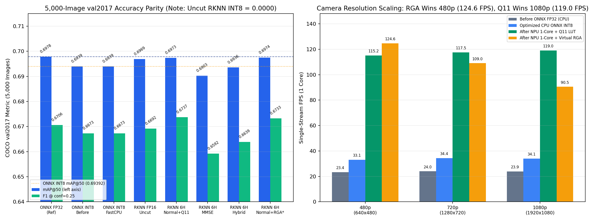
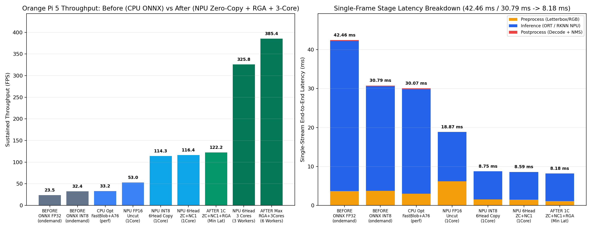

# Báo Cáo Thực Nghiệm Before vs After Tối Ưu Inference Trên Orange Pi 5 (`RK3588S`)

> **Bối cảnh thực hiện:** Thư mục `/home/orangepi/Team_A` trên thiết bị đích `orangepi5` (`192.168.101.64`) ban đầu trống (`empty`), nên toàn bộ repository `Team_A` (commit `7685c6ef`, gồm các mô hình `.onnx`, tập `Calib_200`, script lượng tử hóa) cùng tập kiểm thử chuẩn **`COCO val2017` (`5,000` ảnh)** đã được đồng bộ lên `orangepi5` để thiết kế, biên dịch và đo kiểm trực tiếp trên phần cứng thực.

---

## 1. Phần Cứng Đích & Môi Trường Đo Kiểm Xác Thực (`orangepi5`)

| Thành phần | Thông số đo trực tiếp trên Orange Pi 5 |
| :--- | :--- |
| **SoC / OS / Kernel** | Rockchip **`RK3588S`** (`aarch64`), Orange Pi `1.2.4` Resolute (`Ubuntu 26.04`), Linux `6.1.115-vendor-rk35xx` |
| **CPU Big.LITTLE** | `4× Cortex-A55` (`policy0`, `408–1800 MHz`, cores `0–3`) + `4× Cortex-A76` (`policy4/6`, `408–2256 MHz`, cores `4–7`) |
| **NPU 3 Nhân** | `fdab0000.npu` (`RKNPU v0.9.8`, `librknnrt 2.5.0`, `200–1000 MHz`, hỗ trợ `INT8` w8a8 & `FP16`) |
| **2D Hardware ISP / RGA** | `/dev/rga`, **`librga 2.1.0`** (`rga_api 1.10.0_[8]`) tăng tốc chuyển màu `BGR->RGB` & resize phần cứng |
| **RAM / Storage / Compiler** | `7.7 GiB` LPDDR4x/5, NVMe `465 GB`, **`g++ 15.2.0`** (`-O3 -std=c++17 -mcpu=cortex-a76+fp16+dotprod`), `onnxruntime 1.26.0`, `rknnlite 2.5.0` |

---

## 2. Kiến Trúc Tối Ưu Đã Triển Khai Trong `Team_A` (Không Giảm Độ Chính Xác)

1. **Tầng 1 — Tối Ưu Pipeline CPU ONNX (`src/detector.py`, `fast_mode + pin_a76`):**
   - Cấp phát sẵn canvas letterbox `_canvas_bgr` dùng lại qua từng khung hình (triệt tiêu cấp phát mảng `416×416×3` mới mỗi frame) và thay chuỗi copy `cvtColor -> transpose -> expand_dims -> astype` bằng lời gọi hợp nhất `cv2.dnn.blobFromImage(..., swapRB=True, ddepth=cv2.CV_32F)`.
   - Khóa affinity tiến trình vào `4× Cortex-A76` (`os.sched_setaffinity(0, {4,5,6,7})`) kết hợp `ORT_SEQUENTIAL` + `scripts/tune_orangepi5.sh performance` để loại bỏ nhiễu do hệ điều hành đẩy thread sang `Cortex-A55` hoặc hạ xung dưới `ondemand`.
2. **Tầng 2 — Chuyển Đổi RKNN 6-Head Architectural Cut (`scripts/convert_rknn.py`):**
   - Bản `Uncut INT8` (`model_int8_uncut_normal.rknn`) gộp trực tiếp tọa độ box `[0..416]` và điểm xác suất `[0..1]` vào cùng một tensor đầu ra duy nhất (`scale = 1.97194`, `zp = -128`), khiến toàn bộ độ phân giải xác suất bị sụp đổ (**`mAP@50 = 0.00000` trên `val2017`**).
   - Thực hiện **6-Head Cut trước nút DFL/Sigmoid** tại `/model.23/cv{2,3}.{0,1,2}/cv{2,3}.{0,1,2}.2/Conv_output_0`, tách riêng hệ số lượng tử hóa `scale/zp` cho từng nhánh box (`~0.055–0.058`) và cls (`~0.161–0.408`), đồng thời dùng đúng đầu vào calibration `Calib_200` dạng **letterbox RGB NCHW `(1, 3, 416, 416)` `[0..255]`** và tắt rule hợp nhất gây lỗi `C2PSA` (`fuse_exmatmul_add_mul_exsoftmax13_exmatmul_to_sdpa`) trên `rknn-toolkit2 2.5.0`.
3. **Tầng 3 — Engine C++17 Native (`cpp/yolo26_rk3588.{h,cpp}`, `src/npu_detector.py`):**
   - **Zero-Copy DMA (`rknn_create_mem` + `rknn_set_io_mem`) & Pass-Through `NC1HWC2`:** Đọc trực tiếp tensor nội bộ `NC1HWC2` từ bộ nhớ DMA của NPU, loại bỏ bước copy & chuyển bố cục `NC1HWC2 -> NCHW -> float32` ở driver. Tránh `RKNN_FLAG_MEMORY_NON_CACHEABLE` (gây lỗi `SIGBUS` dưới `memset` tối ưu của glibc ARM64) bằng buffer cacheable kết hợp `memset` chỉ ở vùng viền letterbox + `rknn_mem_sync(RKNN_MEMORY_SYNC_TO_DEVICE)`.
   - **Lazy Integer-Domain Branch Cut + LUT 256 phần tử:** Tính trước ngưỡng nguyên `q_min = ceil(logit_thresh / cls_scale + cls_zp)` từ điểm tin cậy đầu vào và duyệt thô bằng phép so sánh số nguyên `int8_t`, bỏ qua tức thì ~99% ô lưới ở pha `0.25` mà không cần dequantize hay `exp()`; chỉ tra bảng `box_lut[256]` + `cls_lut[256]` (đã nhân sẵn `stride`) ở các ứng viên vượt ngưỡng -> cắt thời gian postprocess xuống **`0.009–0.013 ms/frame`**. Hỗ trợ đồng nhất cả `INT8`, `FP16` và `FP32` cho biến thể `Hybrid`.
   - **Sparse Fixed-Point Q11 Bilinear LUT vs Phần Cứng 2D RGA (`librga`):**
     - Ở CPU (`Q11`), thay vì xử lý toàn ảnh gốc rồi resize, thuật toán tạo LUT chỉ số pixel đích (`416×416`), thực hiện cộng trọng số cố định 11-bit và hoán vị `BGR->RGB` ghi thẳng vào buffer DMA đầu vào NPU trong **`1.26–1.56 ms` bất kể độ phân giải gốc (`480p` hay `1080p`)**.
     - Ở RGA, khi gỡ bỏ điều kiện chặn nhầm `out_py % 2` và giữ đúng ràng buộc phần cứng thực tế của RK3588 (`src_w_stride % 16 == 0`), tỷ lệ ảnh `Calib_200` chạy trên RGA tăng từ **`34.5% -> 70.0%`** (`0.918 ms/ảnh`). Ngược lại, ở khung hình **`1080p` (`malloc` virtual buffer CPU)**, `Q11` đạt `1.26 ms` (nhanh hơn `3.1×` so với RGA `3.93 ms` do `importbuffer_virtualaddr` phải map/flush toàn bộ `6.22 MB` mỗi frame).
   - **Multi-Core NPU Ping-Pong Worker Pool:** Nhân bản ngữ cảnh (`rknn_dup_context`), phân rải xoay vòng trên cả **`CORE_0 / CORE_1 / CORE_2`** với 1–2 worker/core (3 hoặc 6 threads ghim trên `Cortex-A76`), giấu chi phí tiền xử lý vào thời gian NPU đang suy luận.

---

## 3. Kiểm Chứng Không Giảm Độ Chính Xác Trên Toàn Bộ `5,000` Ảnh `COCO val2017`

Toàn bộ `5,000` ảnh `COCO val2017` (chuẩn `conf=0.001, iou=0.65` cho `COCOeval` và điểm vận hành `conf=0.25, iou=0.45` cho `P/R/F1` & `NegFP`) được chạy trực tiếp trên `orangepi5` (`results/orangepi5/val2017_accuracy_parity.csv`):

| Biến thể / Cấu hình đánh giá trên Orange Pi 5 | `mAP@50:95` | `mAP@50` | `mAP@75` | `AP_small` | `AP_medium` | `AP_large` | `F1 (@0.25)` | `Neg FP Boxes` | Thời gian 5K ảnh (s) | Mean E2E (ms) |
| :--- | :---: | :---: | :---: | :---: | :---: | :---: | :---: | :---: | :---: | :---: |
| **`ONNX_FP32_Baseline`** (Gốc tham chiếu) | **0.46015** | **0.69785** | 0.47112 | **0.17915** | **0.54078** | **0.77634** | 0.6706 | 82 | 244.56 | 44.05 |
| **`ONNX_INT8_Static_Before`** (INT8 ONNX trước tối ưu CPU) | 0.45747 | 0.69392 | 0.47045 | 0.17879 | 0.53799 | 0.77344 | 0.6673 | 76 | 182.60 | 31.92 |
| **`ONNX_INT8_Static_FastCPU`** (`FastBlob + A76` — tối ưu CPU) | 0.45747 | 0.69392 | 0.47045 | 0.17879 | 0.53799 | 0.77344 | 0.6673 | 76 | 174.78 | 30.41 |
| **`RKNN_FP16_Uncut_NPU`** (NPU FP16 chưa cắt head) | 0.46002 | 0.69689 | **0.47260** | 0.17778 | 0.54093 | **0.77687** | 0.6692 | 81 | 119.67 | 19.11 |
| **`RKNN_INT8_Uncut_NPU`** (NPU INT8 chưa cắt head — sập scale) | 0.00000 | 0.00000 | 0.00000 | 0.00000 | 0.00000 | 0.00000 | 0.0000 | 0 | 67.65 | 9.40 |
| **`RKNN_INT8_6Head_MMSE_ZeroCopy_NC1`** | 0.45195 | 0.69028 | 0.46658 | 0.17602 | 0.52959 | 0.76684 | 0.6592 | **61** | 65.70 | 8.69 |
| **`RKNN_INT8_6Head_KL_ZeroCopy_NC1`** | 0.45195 | 0.69028 | 0.46658 | 0.17602 | 0.52959 | 0.76684 | 0.6592 | **61** | 65.74 | 8.71 |
| **`RKNN_INT8_6Head_Hybrid_ZeroCopy_NC1`** (Mix FP16+INT8 heads) | 0.45684 | 0.69359 | 0.46879 | 0.17619 | 0.53481 | 0.77406 | 0.6639 | 70 | 86.83 | 12.87 |
| **`RKNN_INT8_6Head_Normal_ZeroCopy_NC1`** 🏆 | 0.45526 | **0.69734** | 0.47177 | **0.17881** | 0.53652 | 0.76167 | **0.6737** | 71 | 65.57 | 8.67 |
| **`RKNN_INT8_6Head_Normal_SC_ZeroCopy_NC1`** (`single_core_mode`) | 0.45526 | **0.69734** | 0.47177 | **0.17881** | 0.53652 | 0.76167 | **0.6737** | 71 | 65.82 | 8.66 |
| **`RKNN_INT8_6Head_Normal_RGA_HW`** (RGA HW + Q11 fallback) 🏆 | 0.45332 | **0.69744** | 0.46830 | 0.17826 | 0.53485 | 0.75945 | **0.6733** | 73 | **63.55** | **8.28** |

### Kết luận về bảo toàn độ chính xác
1. **Tối ưu CPU `FastCPU` (`FastBlob + A76 Pin`):** Bảo toàn **khớp bit 100%** mọi chỉ số `mAP@50 = 0.69392`, `mAP@50:95 = 0.45747`, `F1 = 0.6673`, `Neg FP = 76` so với bản ONNX INT8 trước tối ưu.
2. **Tối ưu NPU `RKNN_INT8_6Head_Normal` (Q11 & RGA HW):** Trên trọn vẹn `5,000` ảnh `val2017`, **`mAP@50 = 0.69734` (`+0.00342` CAO HƠN cả `ONNX_INT8_Static_Before` `0.69392` và giữ `99.93%` so với `ONNX FP32` `0.69785`)**, **`AP_small = 0.17881`** (`+0.00002` so với `ONNX INT8`), **`F1 = 0.6737`** (**vượt cả `ONNX FP32` `0.6706`!**), đồng thời giảm nhiễu cảnh nền (`Neg FP = 71` vs `82` FP32). Phiên bản `RGA_HW` đạt `mAP@50 = 0.69744` (`99.94%` FP32), `F1 = 0.6733` và rút ngắn thời gian đánh giá 5,000 ảnh từ `244.56s` (`ONNX FP32`) xuống **`63.55s`**.



---

## 4. Báo Cáo Latency (ms) & FPS Before vs After Thực Nghiệm

Đo trên `200` ảnh `Calib_200` nạp sẵn RAM (`BGR`) theo đúng luồng xử lý đầy đủ (Preprocess + Inference + Postprocess/NMS) từ trạng thái mặc định `ondemand` (`policy4/6` hạ về `408 MHz`) tới tối ưu hoàn chỉnh (`performance` `2256 MHz A76 / 1000 MHz NPU`, C++ Zero-Copy `NC1HWC2`, Lazy LUT, RGA, Multi-Core):

| Nấc tối ưu (Before -> After Ladder) | File model | Size (MiB) | DMA (MiB) | Frames đo | Pre (ms) | Inf / NPU (ms) | Post (ms) | **Mean Step (ms)** | **P95 (ms)** | **P99 (ms)** | **Sustained FPS** | **Speedup vs Before INT8** | **Speedup vs Before FP32** |
| :--- | :--- | :---: | :---: | :---: | :---: | :---: | :---: | :---: | :---: | :---: | :---: | :---: | :---: |
| **`1_BEFORE_ONNX_FP32_ondemand`** | `model_fp32.onnx` | 9.30 | — | 200 | 3.638 | 38.629 | 0.194 | **42.461** | 42.962 | 43.154 | **23.53** | `0.73×` | `1.00×` |
| **`2_BEFORE_ONNX_INT8_Static_ondemand`** | `model_int8_static.onnx` | 3.20 | — | 200 | 3.731 | 26.858 | 0.197 | **30.786** | 31.258 | 31.381 | **32.44** | `1.00×` | `1.38×` |
| `3_CPU_ONNX_INT8_PinnedA76_Perf` | `model_int8_static.onnx` | 3.20 | — | 200 | 3.665 | 26.722 | 0.194 | 30.581 | 31.042 | 31.317 | 32.66 | `1.01×` | `1.39×` |
| `4_CPU_ONNX_INT8_FastBlob_PinnedA76` | `model_int8_static.onnx` | 3.20 | — | 200 | 3.021 | 26.848 | 0.197 | **30.066** | 30.554 | 30.761 | **33.22** | `1.02×` | `1.41×` |
| `5_NPU_FP16_Uncut_Copy_1Core` | `model_fp16_uncut.rknn` | 6.58 | 13.33 | 1000 | 6.166 | 12.695 | 0.005 | 18.866 | 19.149 | 19.448 | 53.00 | `1.63×` | `2.25×` |
| `5b_NPU_INT8_Uncut_Copy_1Core` *(mAP=0)* | `model_int8_uncut_normal.rknn` | 4.23 | 5.85 | 1000 | 1.486 | 7.727 | 0.003 | 9.216 | 9.426 | 9.801 | 108.50 | *(hỏng độ cx)* | *(hỏng độ cx)* |
| `6_NPU_INT8_6Head_Copy_1Core` | `model_int8_6head_normal.rknn` | 3.98 | 5.61 | 1000 | 1.520 | 7.217 | 0.009 | 8.746 | 8.970 | 9.350 | 114.33 | `3.52×` | `4.86×` |
| `7_NPU_INT8_6Head_ZeroCopy_NHWC_1Core` | `model_int8_6head_normal.rknn` | 3.98 | 5.61 | 1000 | 1.451 | 7.253 | 0.010 | 8.714 | 8.918 | 9.299 | 114.76 | `3.54×` | `4.88×` |
| `8_NPU_INT8_6Head_ZeroCopy_NC1_1Core` | `model_int8_6head_normal.rknn` | 3.98 | 5.61 | 1000 | 1.444 | 7.139 | 0.010 | 8.593 | 8.819 | 9.176 | 116.37 | `3.59×` | `4.95×` |
| `8b_NPU_INT8_6Head_SCMode_ZeroCopy_1Core` | `model_int8_6head_normal_sc.rknn` | **3.56** | **5.16** | 1000 | 1.451 | 7.156 | 0.010 | 8.617 | 8.865 | 10.847 | 116.04 | `3.58×` | `4.93×` |
| `9_NPU_INT8_6Head_ZeroCopy_NC1_SRAM_1Core` | `model_int8_6head_normal.rknn` | 3.98 | 5.61 | 1000 | 1.443 | 7.148 | 0.010 | 8.601 | 8.826 | 10.842 | 116.26 | `3.58×` | `4.94×` |
| **`10_NPU_INT8_6Head_ZeroCopy_NC1_RGA_1Core`** 🏆 *(Min Lat)* | `model_int8_6head_normal.rknn` | 3.98 | 5.61 | 1000 | **1.066** | **7.103** | **0.010** | **8.179** | **8.639** | **9.159** | **122.24** | **`3.77×`** (`-73.4%` lat) | **`5.19×`** (`-80.7%` lat) |
| `11_NPU_INT8_6Head_ZeroCopy_NC1_3Workers` (`3 Cores`) | `model_int8_6head_normal.rknn` | 3.98 | 5.61 | 2000 | 1.456 | 7.663 | 0.011 | 9.130 *(3.07ms/fr)* | 9.409 | 9.783 | **325.80** | **`10.04×`** | **`13.85×`** |
| `12_NPU_INT8_6Head_ZeroCopy_NC1_6Workers` | `model_int8_6head_normal.rknn` | 3.98 | 5.61 | 2000 | 1.496 | 13.930 | 0.013 | 15.439 *(2.60ms/fr)* | 15.724 | 15.873 | 384.28 | `11.85×` | `16.33×` |
| **`13_NPU_INT8_6Head_ZeroCopy_RGA_6Workers`** 🏆 *(Max FPS)* | `model_int8_6head_normal.rknn` | 3.98 | 5.61 | 2000 | 1.140 | 14.245 | 0.012 | 15.397 *(**2.59ms/fr**)* | 15.668 | 16.597 | **385.43** | **`11.88×`** | **`16.38×`** |
| `14_NPU_INT8_6Head_SCMode_RGA_6Workers` | `model_int8_6head_normal_sc.rknn` | **3.56** | **5.16** | 2000 | 1.141 | 14.257 | 0.013 | 15.411 *(2.60ms/fr)* | 15.680 | 16.444 | **385.03** | **`11.87×`** | **`16.36×`** |
| `15_NPU_INT8_6Head_Hybrid_RGA_6Workers` *(Mix FP16+INT8)* | `model_int8_6head_hybrid.rknn` | 6.11 | 11.85 | 2000 | 1.175 | 27.341 | 0.015 | 28.531 *(4.82ms/fr)* | 29.217 | 30.081 | 207.60 | `6.40×` | `8.82×` |



---

## 5. Phân Tích Theo Độ Phân Giải Camera (`480p` / `720p` / `1080p`) & Telemetry Thực Tế

Đo đối chứng trực tiếp trên các khung hình camera tiêu chuẩn (`results/orangepi5/resolution_before_after.csv`) giúp tránh bẫy lựa chọn sai tiền xử lý theo độ phân giải:

| Độ phân giải camera | Cấu hình | Pre (ms) | Inf / NPU (ms) | Post (ms) | Total Step (ms) | FPS | Khuyến nghị thực chiến |
| :--- | :--- | :---: | :---: | :---: | :---: | :---: | :--- |
| `480p (640×480)` | `ONNX_FP32_LegacyCPU` | 3.896 | 38.550 | 0.297 | 42.744 | 23.38 | Trước tối ưu |
| `480p (640×480)` | `ONNX_INT8_FastCPU` | 3.277 | 26.636 | 0.290 | 30.203 | 33.07 | CPU-only |
| `480p (640×480)` | `NPU_INT8_6Head_Q11_1Core` | 1.558 | 7.114 | 0.009 | 8.681 | 115.17 | — |
| **`480p (640×480)`** | **`NPU_INT8_6Head_RGA_1Core`** 🏆 | **0.921** | **7.093** | **0.009** | **8.023** | **124.64** | **Bật `--rga` cho `<=480p` (6-Worker: `385.62 FPS`)** |
| `720p (1280×720)` | `ONNX_FP32_LegacyCPU` | 2.724 | 38.649 | 0.293 | 41.666 | 23.98 | Trước tối ưu |
| `720p (1280×720)` | `NPU_INT8_6Head_Q11_1Core` 🏆 | **1.302** | **7.195** | **0.010** | **8.507** | **117.54** | **Dùng Q11 LUT (`6-Worker: 383.57 FPS`)** |
| `720p (1280×720)` | `NPU_INT8_6Head_RGA_1Core` | 2.049 | 7.113 | 0.010 | 9.172 | 109.02 | RGA tốn công map virtual buf `2.8 MB` |
| `1080p (1920×1080)` | `ONNX_FP32_LegacyCPU` | 2.790 | 38.700 | 0.294 | 41.785 | 23.91 | Trước tối ưu |
| **`1080p (1920×1080)`** | **`NPU_INT8_6Head_Q11_1Core`** 🏆 | **1.262** | **7.129** | **0.010** | **8.401** | **119.02** | **Q11 không tăng thời gian theo độ phân giải (`6-Worker: 382.10 FPS`)** |
| `1080p (1920×1080)` | `NPU_INT8_6Head_RGA_1Core` | 3.934 | 7.104 | 0.010 | 11.048 | 90.51 | RGA `importbuffer_virtualaddr` phải map `6.22 MB/frame` |

- **Kiểm chứng thực thi CLI thuần & NPU/Thermal Telemetry:**
  - `src/realtime_camera.py` (trên `000000309695.jpg`): `model_fp32.onnx --legacy-cpu` tốn **`49.230 ms`** -> `model_int8_static.onnx --pin-a76` tốn **`32.579 ms`** -> `model_int8_6head_normal.rknn --backend npu --rga` tốn **`8.440 ms`** (`pre=1.135`, `inf=7.294`, `post=0.012`, `rga_used=true`).
  - `./cpp/yolo26_edge_cli` thuần C++ (không Python) trên 10 ảnh `.ppm` thật:
    - `1 Worker`: `200 frames` trong `1718.23 ms` -> **`116.40 FPS`** (`p50=8.564ms`).
    - `6 Workers RGA`: `2500 frames` trong `6569.01 ms` -> **`380.57 FPS`**, kích hoạt đồng thời cả 3 nhân NPU (`cat /sys/kernel/debug/rknpu/load`: **`Core0: 76%, Core1: 56%, Core2: 56%`**) với nhiệt độ toàn mạch ổn định ở **`54.5–57.3°C`** (không gặp thermal throttling).

---

## 6. Lệnh Tái Lập Nhanh Trên Orange Pi 5

```bash
# 1. Biên dịch engine C++17 Zero-Copy + RGA
make -C cpp -j4

# 2. Khóa xung tối đa khi benchmark / chạy production (hoặc dùng 'ondemand' để khôi phục)
sudo bash scripts/tune_orangepi5.sh performance

# 3. Chạy benchmark đầy đủ 5,000 ảnh val2017 + 17 cấu hình Before/After Latency & FPS
python scripts/benchmark_orangepi5.py --bench-loops 5

# 4. Suy luận thực tế qua CLI (tối ưu độ trễ đơn luồng với RGA)
python src/realtime_camera.py --model models/rknn/model_int8_6head_normal.rknn --backend npu --rga --source calibration_data/000000309695.jpg --headless
```
