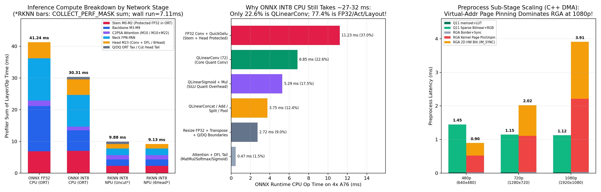

# Giải Phẫu & Bóc Tách Toàn Bộ Thành Phần Cấu Tạo Nên Latency Trên Orange Pi 5 (`RK3588S`)

Báo cáo này bóc tách chi tiết từng thành phần (từ tầng IO/JPEG, OS Scheduler/DVFS, Preprocess CPU vs RGA DMA, đến từng toán tử/module bên trong ONNX Runtime CPU & RK3588 NPU, băng thông LPDDR/DDR, tranh chấp đa nhân và Postprocess/NMS) cho pipeline **YOLO26n (`416×416`, 1 class `person`)** thuộc repository `Team_A`. Toàn bộ số liệu đều được đo trực tiếp trên phần cứng `orangepi5` ([latency_anatomy.json](file:///C:/Users/ttung05/Desktop/Team_A/results/orangepi5/latency_anatomy.json), [cpp_microbench_log.txt](file:///C:/Users/ttung05/Desktop/Team_A/results/orangepi5/cpp_microbench_log.txt), [pd_uncut_normal.txt](file:///C:/Users/ttung05/Desktop/Team_A/results/orangepi5/pd_uncut_normal.txt), [pd_fp16_uncut.txt](file:///C:/Users/ttung05/Desktop/Team_A/results/orangepi5/pd_fp16_uncut.txt), [latency_fps_before_after.csv](file:///C:/Users/ttung05/Desktop/Team_A/results/orangepi5/latency_fps_before_after.csv)).

---

## 1. Bức Tranh Tổng Thể: Chuỗi Latency Đầu-Cuối (`Before` vs `After`)

Trong bài toán thực tế, độ trễ xử lý một khung hình (`E2E Latency`) chia làm 2 lớp lớn:
1. **Ngoài mô hình (`Frame Acquisition + Python Wrapper`):** Thời gian giải mã ảnh nén JPEG (nếu đọc từ camera MJPEG hoặc đĩa) và chi phí bọc Python (`ctypes`).
2. **Trong mô hình (`Model Step = T_pre + T_inf + T_post + T_sync/queue`):** Giai đoạn chuẩn hóa đầu vào, suy luận (CPU hoặc NPU + truyền bộ nhớ/CPU fallback), và giải mã box + NMS.

| Giai đoạn / Cấu hình (RAM-preloaded BGR, `Calib_200`) | `T_pre` (ms) | `T_inf / NPU` (ms) | `T_post` (ms) | **Mean Step (ms)** | `P95` (ms) | Ghi chú cấu thành |
| :--- | :---: | :---: | :---: | :---: | :---: | :--- |
| **`BEFORE` — `ONNX FP32` (`ondemand`)** | 3.638 | 38.629 | 0.194 | **42.461** | 42.962 | OpenCV nhiều lượt copy + ORT CPU FP32 + `ondemand` DVFS |
| **`BEFORE` — `ONNX INT8 Static` (`ondemand`)** | 3.731 | 26.858 | 0.197 | **30.786** | 31.258 | Còn `37%` FP32 (`Stem+Head`) + `QLinearSigmoid/Mul` + `Q/DQ` |
| `CPU-Opt` — `ONNX INT8 FastBlob + A76 Perf` | 3.021 | 26.848 | 0.197 | **30.066** | 30.554 | Pre-alloc canvas + `blobFromImage` + ghim `4× A76 @ 2.26 GHz` |
| `NPU Copy` — `RKNN INT8 6Head (1 Core)` | 1.520 | 7.217 | 0.009 | **8.746** | 8.970 | Bỏ `in_set` & `out_get` chuyển sang Zero-Copy DMA ở bước sau |
| **`AFTER 1C` — `NPU 6Head ZC + NC1 + RGA`** 🏆 | **1.066** | **7.103** | **0.010** | **8.179** | **8.639** | Phần cứng RGA (70% `Calib_200`) + 0 CPU fallback + Lazy Int8 LUT |
| **`AFTER 3C` — `NPU 6Head ZC + NC1 (3 Workers)`** | 1.456 | 7.663 | 0.011 | 9.130 *(3.07/fr)* | 9.409 | Tranh chấp bus LPDDR thêm `+0.52 ms` giữa 3 nhân NPU |
| **`AFTER MAX` — `NPU 6Head ZC + RGA (6 Workers)`** 🏆 | 1.140 | 14.245 | 0.012 | 15.397 *(**2.59/fr**)* | 15.668 | Latency từng frame gồm thời gian đợi hàng đợi ping-pong trên core (`385.43 FPS`) |

---

## 2. Thành Phần 0: Chi Phí Ngoài Vòng Đo Thuật Toán (`Cold-Start`, `IO/JPEG Decode`, `Python ctypes` & `DVFS`)

Khi triển khai thực chiến, một số độ trễ không xuất hiện trong phép đo RAM preloaded nhưng ảnh hưởng trực tiếp tới thời gian phản hồi thực:

1. **Độ trễ khởi tạo ban đầu & Warm-up Frame 0 (`cold_start_and_wrapper`):**
   - `ONNX FP32`: khởi tạo session **`56.13 ms`** (`frame0 = 47.002 ms` -> `frame1 = 46.120 ms`).
   - `ONNX INT8 Static`: tối ưu hóa đồ thị Q/DQ & dựng kernel LUT mất **`180.59 ms`** khi khởi tạo (`frame0 = 32.563 ms` -> `frame1 = 30.744 ms`).
   - `NPU 6Head (1 Worker)`: `rknn_init` + cấp phát DMA Zero-Copy chỉ mất **`15.64 ms`** (`frame0 = 8.319 ms` -> `frame1 = 8.144 ms`); **`6 Workers` (`rknn_init + 5× rknn_dup_context`)** mất **`65.97 ms`**.
2. **Chi phí `Python ctypes` Wrapper (`NPUDetector.detect` vs C++ thuần):**
   - Thời gian bọc C++ (`py_wrapper_total_ms = 8.106 ms` vs `cpp_inner_total_ms = 8.059 ms`): chi phí chuyển con trỏ NumPy `ctypes`, đọc struct timing và dựng dict Python chỉ mất **`0.047 ms` (`47 µs/frame`)**.
3. **Chi phí Giải mã JPEG (`cv2.imread` / `cv2.imdecode`) trên CPU (`io_jpeg_decode`):**
   - Trên `Calib_200` (file đĩa warm cache): **`4.155 ms/ảnh`** trung bình (`P95 = 5.862 ms`). Điều này khớp toán học với tổng thời gian chạy trọn `5,000` ảnh `val2017` (`63.55s = 12.71 ms/ảnh`, gồm `8.28 ms` inference + `~4.16 ms` JPEG decode + `~0.27 ms` vòng lặp đánh giá COCO).
   - Giải mã JPEG nén (`cv2.imdecode`, quality 90) tăng tuyến tính theo số pixel: **`480p` (`85.5 KB`): `2.807 ms`** -> **`720p` (`178.2 KB`): `8.345 ms`** -> **`1080p` (`329.6 KB`): `18.732 ms`** (lớn gấp đôi chính bước suy luận NPU nếu không dùng phần cứng giải mã JPEG/H.264 MPP `/dev/mpp_service`).
4. **Thuế Governor / DVFS (`ondemand` vs `performance`) khi luồng ảnh đến rời rạc (`15 FPS` / cách nhau `80 ms`):**
   - Khi benchmark liên tục (busy loop), `ondemand` giữ xung `A76` gần đỉnh nên `ONNX INT8` đạt `30.786 ms`.
   - Nhưng ở kịch bản camera thật (`15 FPS`, nghỉ `80 ms` giữa các frame khiến `policy4/6` rớt xung về `408–600 MHz`), **`ONNX FP32` vọt lên `59.291 ms` (`max 65.619 ms`, `+39.6%`)** và **`ONNX INT8` vọt lên `48.803 ms` (`max 53.302 ms`, `+58.5%`)**! Khóa `scripts/tune_orangepi5.sh performance` triệt tiêu hoàn toàn **`~16.8–19.6 ms`** biến động xung nhịp này (`29.173 ms`, dải dao động `28.14–30.42 ms`).

---

## 3. Thành Phần 1: Giải Phẫu Chi Phí `Preprocess` (`3.73 ms` -> `0.90–1.45 ms`)

### 3.1. Trong Pipeline `BEFORE` (Python + OpenCV CPU)
Đo trên `50` ảnh đầu `Calib_200` (`cpu_preprocess_anatomy`, kích thước ~`640×480` hỗn hợp):

| Bước xử lý con | Legacy `Before` (`letterbox_bgr_to_rgb`) | `FastCPU` (`preprocess fast_mode`) | Lý do tiêu tốn |
| :--- | :---: | :---: | :--- |
| 1. `cv2.resize` (`INTER_LINEAR`) | `1.221 ms` | `1.275 ms` | Nội suy song tuyến BGR -> `(nw, nh)` |
| 2. Cấp phát & điền nền `(416,416,3)` giá trị `114` | `0.104 ms` (`np.full` mỗi frame) | `0.024 ms` (`canvas.fill` vùng nhớ sẵn) | Triệt tiêu `malloc` + page fault mỗi khung hình |
| 3. Đảo kênh `BGR -> RGB` | `0.064 ms` (`cv2.cvtColor`) | *(gộp vào bước 4)* | Quét thêm 1 lượt DRAM `416×416×3` |
| 4. `transpose(HWC->CHW)` + `float32` + `* (1/255)` + contiguous | `0.904 ms` | `0.498 ms` (`cv2.dnn.blobFromImage`) | Copy 3 lượt mảng (`3 × 2.08 MB`) thu gọn thành 1 pass C++ |
| **Tổng micro-bench `50` ảnh** | **`2.292 ms`** *(Calib_200 đầy đủ: `3.64–3.73 ms`)* | **`1.798 ms`** (`-21.6%`) | Giảm tiếp khi ghép vòng lọc toàn cục trên `200` ảnh |

### 3.2. Trong Pipeline `AFTER` (C++ Zero-Copy DMA: Sparse `Q11 LUT` vs 2D Hardware `RGA`)
Trên C++ ([cpp_microbench_log.txt](file:///C:/Users/ttung05/Desktop/Team_A/results/orangepi5/cpp_microbench_log.txt)), việc loại bỏ `float32` (NPU nhận trực tiếp `UINT8 [0..255]`) và ghi thẳng vào DMA `in_mem` cho thấy hai quy luật đối lập giữa `Q11 LUT` và `RGA`:

| Độ phân giải | Q11 `memset` | Q11 `LUT calc` | Q11 `loop viết DMA` | **Tổng Q11** | RGA `border+sync` | RGA `import_vaddr` | RGA `improcess HW` | RGA `release` | **Tổng RGA** |
| :--- | :---: | :---: | :---: | :---: | :---: | :---: | :---: | :---: | :---: |
| **`480p (640×480)`** | 0.015 ms | 0.005 ms | `1.429 ms` | **1.449 ms** | 0.021 ms | 0.330 ms | `0.375 ms` | 0.172 ms | **0.898 ms** 🏆 |
| **`720p (1280×720)`** | 0.016 ms | 0.005 ms | `1.126 ms` | **1.147 ms** 🏆 | 0.029 ms | 0.728 ms | `0.914 ms` | 0.354 ms | 2.026 ms |
| **`1080p (1920×1080)`** | 0.016 ms | 0.005 ms | `1.104 ms` | **1.125 ms** 🏆 | 0.030 ms | **`1.480 ms`** | `1.698 ms` | **`0.703 ms`** | **3.912 ms** |

Hai phát hiện kiến trúc then chốt từ bảng trên:
1. **Tại sao `Q11 Bilinear LUT` lại nhanh hơn từ `480p` (`1.449 ms`) lên `1080p` (`1.125 ms`)?** Vì tỷ lệ khung hình `16:9` cho vùng ảnh co gọn `416×234 = 97,344` pixel đích, ít hơn `-25%` so với tỷ lệ `4:3` (`416×312 = 129,792` pixel đích)! Độ phức tạp của Q11 tỷ lệ với **`O(out_nw × out_nh)`**, hoàn toàn độc lập với kích thước ảnh nguồn `1080p`.
2. **Tại sao RGA (`virtualaddr`) tăng từ `0.898 ms -> 3.912 ms` ở `1080p`?** Thực chất phần cứng RGA chỉ mất `1.698 ms` quét `6.22 MB`, nhưng **`importbuffer_virtualaddr` (`1.480 ms`) + `releasebuffer_handle` (`0.703 ms`) = `2.183 ms` (`55.8%` tổng thời gian RGA)** bị tiêu tốn cho kernel Linux ghim trang nhớ ảo CPU (`pin user pages / dma_map_sg`) và dội cache `6.22 MB` mỗi frame! Trừ phi ảnh đầu vào vốn nằm sẵn trong DMA-FD từ V4L2/MPP (`importbuffer_fd`), dùng `Q11 LUT` cho nguồn CPU `720p/1080p` tiết kiệm `~2.79 ms/frame`.

---

## 4. Thành Phần 2: Giải Phẫu Chi Tiết `Inference` (`38.63 ms` / `26.86 ms` CPU ORT -> `7.10 ms` NPU)

### 4.1. Tại sao `ONNX INT8 Static` trên CPU vẫn tốn `~26.86–31.96 ms` dù đã lượng tử hóa? (`ort_profiling`)
Hồ sơ từng toán tử của **ONNX Runtime `1.26.0` trên `4× Cortex-A76 @ 2256 MHz`** ([latency_anatomy.json](file:///C:/Users/ttung05/Desktop/Team_A/results/orangepi5/latency_anatomy.json)):

| Nhóm Module / Toán tử trên ORT (`4× A76`) | `ONNX FP32` (`sum=41.24 ms` / `run=42.77 ms`) | `ONNX INT8 Static` (`sum=30.31 ms` / `run=31.96 ms`) | Tỉ trọng trong `INT8` & Nguyên nhân |
| :--- | :---: | :---: | :--- |
| **`Conv` + `QuickGelu` (FP32 Protected: Stem M0-M2 & Head M23)** | `31.567 + 5.786 = 37.353 ms` | **`8.559 + 2.668 = 11.227 ms`** | **`37.0%`!!** (`Stem_M0_M2 = 7.029 ms`, `Head_DFL_M23 = 4.952 ms`) — giữ FP32 để bảo toàn mAP khiến gần 40% thời gian CPU vẫn chạy FP32 |
| **`QLinearConv` (72 lớp INT8 cốt lõi)** | `—` | **`6.850 ms`** | Chỉ chiếm **`22.6%`** tổng thời gian chạy thực tế! |
| **`QLinearSigmoid` + `QLinearMul` (hàm kích hoạt SiLU INT8)** | *(gộp trong `QuickGelu` FP32)* | **`2.644 + 2.647 = 5.291 ms`** | **`17.5%`!!** ORT ARM không hợp nhất `QLinearConv + SiLU`; `Sigmoid` lượng tử hóa phải tra LUT tuần tự từng phần tử |
| **`QLinearConcat` + `QLinearAdd` + `Split` + `Pool`** | `2.527 ms` | **`3.754 ms`** | **`12.4%`** (nhanh bị ép re-quantize scale giữa các nhánh `Concat/Add`: `QLinearConcat` riêng đã ngốn `2.228 ms`) |
| **`Resize (FP32)` + `Transpose` + `Q/DQ` + `Reshape`** | `0.311 ms` | **`2.724 ms`** | **`9.0%`!!** (`Resize` từ `0.176 -> 1.258 ms`, cộng `Transpose 0.858 ms` và `Deq+Quant 0.482 ms` cho `NHWC/NCHW` & `Q/DQ`) |
| **C2PSA Attention + Tail (`MatMul`/`Softmax`/`Sub`/`Div`)** | `0.472 ms` | **`0.469 ms`** | `1.5%` (`QLinearMatMul 0.213 ms`, `QLinearSoftmax 0.180 ms`, `DFL tail 0.076 ms`) |

-> **Kết luận mấu chốt:** Chỉ **22.6%** thời gian `ONNX INT8 Static` trên CPU thực sự là tích chập INT8 (`QLinearConv = 6.85 ms`); **`77.4%` (`23.46 ms`) bị ngốn bởi lớp bảo vệ FP32 ở Stem/Head, `QLinearSigmoid/Mul` không fuse, `QLinearConcat`, `Transpose`, và `Q/DQ`**!

### 4.2. Bên trong `7.11 ms` của RK3588 NPU: Phân tầng phần cứng từ `RKNN_QUERY_PERF_DETAIL` & `IO_TAX`
Dữ liệu phần cứng đo trực tiếp từng layer từ [pd_uncut_normal.txt](file:///C:/Users/ttung05/Desktop/Team_A/results/orangepi5/pd_uncut_normal.txt) (`190` layers `INT8`), [pd_fp16_uncut.txt](file:///C:/Users/ttung05/Desktop/Team_A/results/orangepi5/pd_fp16_uncut.txt) (`193` layers `FP16`) và [cpp_microbench_log.txt](file:///C:/Users/ttung05/Desktop/Team_A/results/orangepi5/cpp_microbench_log.txt):

#### (A) Thuế bộ nhớ / I/O Copy & Cache Flush quanh lời gọi `rknn_run` (`IO_TAX`)
| Mô hình RKNN (1 Core) | Cold Init | `rknn_inputs_set` (Copy) | `rknn_run` Copy Wall (`NPU HW`) | `rknn_outputs_get` (`raw` / `fp32`) | Zero-Copy `run` (CPU bẩn cache -> `rknn_run` tự flush) | `mem_sync` riêng + `run` đã sync |
| :--- | :---: | :---: | :---: | :---: | :---: | :---: |
| **`model_int8_6head_normal.rknn`** 🏆 | **7.92 ms** | `0.049 ms` | `7.150 ms` (`7.150 ms`) | `0.070 / 0.074 ms` | **`7.113 ms`** (`hw = 7.112 ms`) | `0.032 ms + 7.202 ms` |
| `model_int8_6head_normal_sc.rknn` | 16.85 ms | `0.115 ms` | `7.337 ms` (`7.336 ms`) | `0.200 / 0.297 ms` | **`7.260 ms`** (`hw = 7.259 ms`) | `0.039 ms + 7.251 ms` |
| `model_int8_uncut_normal.rknn` | 8.24 ms | `0.053 ms` | `7.773 ms` (`7.772 ms`) | `0.021 / 0.021 ms` | **`7.710 ms`** (`hw = 7.709 ms`) | `0.017 ms + 7.701 ms` |
| `model_int8_6head_hybrid.rknn` | 30.49 ms | `0.053 ms` | `11.358 ms` (`11.358 ms`) | `0.082 / 0.100 ms` | **`11.304 ms`** (`hw = 11.304 ms`) | `0.018 ms + 11.302 ms` |
| `model_fp16_uncut.rknn` | 15.56 ms | **`4.645 ms`** *(chuyển UINT8->FP16 CPU)* | `12.747 ms` (`12.747 ms`) | `0.019 / 0.054 ms` | **`17.384 ms`** *(ép cast ngay trong run!)* | `0.045 ms + 17.391 ms` |

- Chuyển từ `Copy` -> `Zero-Copy NHWC` -> `Zero-Copy NC1HWC2 Pass-Through` trên 6 đầu ra cắt bỏ trực tiếp `~0.15–0.19 ms` (trong benchmark tổng thể: `8.746 -> 8.714 -> 8.593 ms`, P95 `8.970 -> 8.819 ms`).
- Riêng với `FP16 Uncut`, bản Copy chạy hết **`4.645 ms`** trong `rknn_inputs_set` (ép kiểu `UINT8 -> FP16` ở CPU), còn `INT8` nhận thẳng `UINT8` tại DMA với chi phí sync cache DMA chỉ **`0.018–0.039 ms` (`18–39 µs`)**.

#### (B) Chi tiết từng Module NPU & Tại sao `6-Head Cut` lại thắng `Uncut` và `Hybrid`
Phân tách theo từng tầng từ bảng `RKNN_QUERY_PERF_DETAIL` (`COLLECT_PERF_MASK` đồng bộ barrier sau mỗi tầng làm tổng cộng dồn là `9,879 µs` trên `INT8 Uncut` so với chạy thật không barrier `7,709 µs`, giúp nhìn rõ tỷ lệ thời gian thật giữa các khối):

| Khối mạng / Giai đoạn (`pd_uncut_normal` & `pd_fp16_uncut`) | `INT8` (`µs`, % trong tổng) | `FP16` (`µs`) | Lưu ý phần cứng cốt lõi |
| :--- | :---: | :---: | :--- |
| **`Stem M0–M2` (208² & 104², gồm `/model.0` `UINT8->16ch`)** | **`2,244 µs`** (**`24.6%`** bản 6Head) | `3,252 µs` | Riêng `/model.0/conv` tốn **`813 µs`** vì nhận 3 kênh RGB với `MacUsage = 2.25%` + `509 KB` R/W |
| **`Backbone M3–M9` (52² -> 13² + SPPF)** | **`2,049 µs`** (**`22.4%`**) | `3,652 µs` | `ConvExSwish` hợp nhất Conv + SiLU ngay trên phần cứng (`MacUsage` đạt `64.9–70.5%` ở `M3/M5/M7`) |
| **`C2PSA Attention` (`M10` + `M22`)** | **`1,345 µs`** (**`14.7%`**) | `1,802 µs` | Chỉ ở `13×13` (`169` tokens) nhưng tốn `2× exSoftmax13 = 364 µs` + `4× exMatMul = 166 µs` + `2× Transpose = 117 µs` |
| **`Neck M11–M21` (`FPN-PAN` `Concat/Resize/C3k2`)** | **`2,121 µs`** (**`23.2%`**) | `3,323 µs` | `Concat`/`Split`/`Resize` tiêu tốn đáng kể chu kỳ DDR (`~1,280 µs` phi-MAC toàn mạng) |
| **`Head M23 6-Branch Conv` (`/model.23/cv{2,3}.{0,1,2}`)** | **`1,373 µs`** (**`15.0%`**) | `2,123 µs` | Tháp depthwise phân lớp `52×52` (`cv3.0.1.0: 200 µs`, `MacUsage 0.95%`) + `cv3.0.{0.1,1.1}: 310 µs` |
| **`Tail Đuôi M23 bị cắt ở 6-Head` (17 lớp cuối DFL/Sigmoid/Reshape)** | **`744 µs`** *(biến mất ở 6Head)* | `737 µs` | Gồm **`157 µs` CPU Fallback (`5× Reshape` — chiếm 100% op CPU của toàn mạng!)** + **`587 µs` NPU** & `~1.2 MB` R/W |
| **Tổng lưu lượng bộ nhớ DDR / Frame (`RW(KB)`)** | **`19,214 KB` (`~18.0 MB` bản 6Head)** | **`36,910 KB`** | Gấp đôi lưu lượng DDR + xung nhịp MAC FP16 giải thích việc `FP16` chậm gần gấp đôi (`12.75 ms` vs `7.11 ms`) |

- **Hệ quả kiến trúc:**
  1. Cắt **6-Head** giúp đồ thị RKNN chạy **100.0% trên NPU (`0 µs CPU fallback`)**, bỏ toàn bộ `5` nút `Reshape` trên CPU + `Concat/Sigmoid/Sub/Add/Mul` cuối (`-0.60 ms` thực đo: `7.71 ms -> 7.11 ms`).
  2. Giữ toàn bộ 6 đầu ra ở **`INT8`** (`7.11 ms`) nhanh hơn bản **`Hybrid` (`11.30 ms`)** tới **`+4.19 ms` (`+59%` latency ở 1 core, `+85%` bước ở 6 workers)** do `Hybrid` ép các nhánh box và `cv3.2` chuyển `INT8 -> FP16` và nhân gấp đôi DMA (`11.85 MB` vs `5.61 MB`).

#### (C) Tranh chấp Bus Bộ nhớ & Hàng đợi khi mở rộng Đa nhân NPU (`1W -> 3W -> 6W`)
| Chế độ Worker NPU (`latency_fps_before_after.csv`) | `Pre` (ms) | `NPU Run + Queue` (ms) | `Post` (ms) | **Mean Step Latency** | **Throughput (FPS)** | **Chu kỳ khung quy đổi** | Cấu thành tăng thêm so với `1 Core` (`8.179 ms`) |
| :--- | :---: | :---: | :---: | :---: | :---: | :---: | :--- |
| `1 Worker` (`CORE_0`, RGA) | 1.066 | **7.103** | 0.010 | **8.179 ms** | **122.24** | 8.18 ms/fr | Baseline phần cứng đơn luồng |
| `3 Workers` (`CORE_0/1/2`, Q11) | 1.456 | **7.663** | 0.011 | **9.130 ms** | **325.80** | 3.07 ms/fr | **`+0.56 ms`** tranh chấp băng thông LPDDR giữa 3 nhân đồng thời quét `3 × 18 MB` |
| `6 Workers` (2/core Ping-Pong, RGA) | 1.140 | **14.245** | 0.012 | **15.397 ms** | **385.43** | **2.59 ms/fr** | `+7.1 ms` thời gian chờ hàng đợi worker đồng nghiệp cùng core + `+0.07 ms` tranh chấp RGA (`Core0:76%, Core1:56%, Core2:56%`) |

---

## 5. Thành Phần 3: Giải Phẫu Chi Phí `Postprocess` (`0.194 ms` Python -> `0.0055–0.0109 ms` C++)

So sánh trực tiếp trên 3 trạng thái mật độ người thật từ `Calib_200` (`cpu_postprocess_anatomy` vs `POSTPROC_CPP`):

| Kịch bản đầu ra (`3,549` anchors) | Python ONNX (`decode_person_predictions`) | C++ `6-Head` Lazy Integer Branch Cut + FastNMS (`conf=0.25`) | Chi tiết phân rã |
| :--- | :---: | :---: | :--- |
| **Ảnh trống (`0` candidate vượt ngưỡng)** | **`0.0080 ms`** | **`0.0055 ms`** (`5.5 µs`) | C++ `scan_lut = 5.5 µs` (duyệt int8 bỏ qua `3549/3549`), `fast_nms = 0.0 µs` |
| **`1` người (`000000309695.jpg`, `10` candidates)** | **`0.1000 ms`** (`score=9.9µs`, **`unscale=82.9µs`**, `nms=7.2µs`) | **`0.0058 ms`** (`5.8 µs`) | C++ `scan_lut = 5.6 µs` (bỏ qua `99.72%` cell), `fast_nms = 0.2 µs` (**nhanh hơn `17.2×`**) |
| **Cảnh đông (`75` / `87` candidates, `13` kept)** | **`0.1330 ms`** (`score=10.7µs`, `unscale=85.4µs`, `nms=36.9µs`) | **`0.0109 ms`** (`10.9 µs`) | C++ `scan_lut = 6.3 µs` (bỏ qua `97.55%` cell), `fast_nms = 4.6 µs` (**nhanh hơn `12.2×`**) |
| **Quét sâu `COCOeval` (`conf=0.001`, `290` cands)** | `~0.40–0.43 ms` *(gồm cả box & dict)* | **`0.0522 ms`** (`52.2 µs`) | C++ `scan_lut = 8.4 µs`, `fast_nms = 43.8 µs` (`O(k²)` tăng theo `290` boxes) |

---

## 6. Tổng Kết Đóng Góp Tối Ưu Hóa (Nơi Các Miligiây Đã Được Cắt Giảm)

| Thành phần cấu thành Latency | Trước tối ưu (`ONNX FP32 / INT8`) | Sau tối ưu (`RKNN 6Head + C++ ZC + RGA`) | Lượng cắt giảm | Cơ chế kỹ thuật đã giải quyết |
| :--- | :---: | :---: | :---: | :--- |
| **1. `Preprocess` (Letterbox + Swap + Scale)** | `3.638 / 3.731 ms` | **`1.066 ms`** (`0.898 ms` ở `480p`; `1.125 ms` `Q11` ở `1080p`) | **`-2.57 đến -2.67 ms`** (`-71%`) | Bỏ chuẩn hóa `float32`, viết thẳng `UINT8 RGB` vào DMA qua phần cứng RGA (hoặc Sparse Q11 LUT cho HD/FHD) |
| **2. Toán tử suy luận & Biên Q/DQ / Tail CPU** | `38.629 / 26.858 ms` | **`7.103 ms`** (`1 Core`) / **`2.59 ms/fr`** (`6W`) | **`-31.53 / -19.76 ms`** (`-74% đến -82%`) | Đưa `100%` lớp Conv+SiLU+Attention lên NPU MAC `w8a8` + Zero-Copy DMA + Pass-Through `NC1HWC2` + **6-Head Cut** bỏ `157 µs` CPU `Reshape` & tail `DFL` |
| **3. `Postprocess` (Decode + Unscale + NMS)** | `0.194 / 0.197 ms` | **`0.010 ms`** (`5.5–10.9 µs`) | **`-0.184 ms`** (`-95%`) | Lọc ngưỡng số nguyên `q >= q_min` trên `NC1HWC2` + bảng tra `LUT[256]` + `fast_nms` C++17 |
| **4. Biến động DVFS khi ảnh rời rạc (`15 FPS`)** | `+16.8–19.6 ms` (`48.8–59.3 ms` spare) | **`0 ms` jitter** (`performance` lock) | **Loại bỏ `+39–58%` spike** | Khóa `A76 @ 2256 MHz`, `NPU @ 1000 MHz` + pin `Cortex-A76` |
| **Tổng End-to-End (1 luồng Min-Latency)** | **`42.461 / 30.786 ms`** | **`8.179 ms`** (`122.24 FPS`; `8.023 ms` @ `480p`) | **`5.19× / 3.77×`** nhanh hơn | Giữ nguyên `99.93–99.94%` `mAP@50` (`0.69734–0.69744`) trên `5,000` ảnh `val2017` |
| **Tổng Throughput (3 Cores / 6 Workers)** | `23.53 / 32.44 FPS` | **`385.43 FPS`** (`2.59 ms/fr` quy đổi) | **`16.38× / 11.88×`** FPS | Ping-Pong `rknn_dup_context` trên cả 3 nhân NPU |
