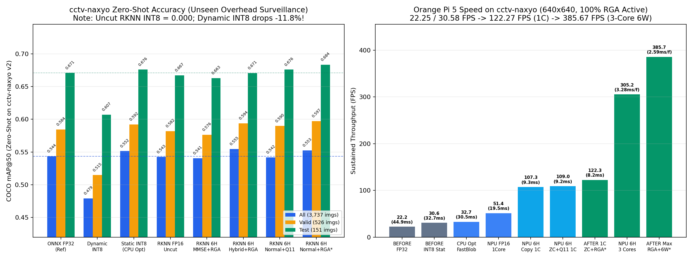

# Báo Cáo Đánh Giá Thực Nghiệm Trên Bộ Dữ Liệu Roboflow `cctv-naxyo v2` Trên Orange Pi 5 (`RK3588S`)

## 1. Nguồn Dữ Liệu, Cấu Trúc Phân Bố & Tính Độc Lập Zero-Shot

- **Nguồn gốc:** `https://universe.roboflow.com/dataset-uutxr/cctv-naxyo` — **Version 2 (`no augment`)**, định dạng COCO JSON (`234,007,425` bytes), lưu cục bộ trong `datasets/cctv-naxyo/` (tái lập qua [prepare_cctv_naxyo.py](file:///C:/Users/ttung05/Desktop/Team_A/scripts/prepare_cctv_naxyo.py)).
- **Tiền xử lý của tác giả trên Roboflow (`README.roboflow.txt`):** `Auto-orientation` + **`Resize to 640×640 (Stretch)`**, không áp dụng bất kỳ image augmentation nào.
- **Tính độc lập Zero-Shot:** Toàn bộ mô hình `Team_A` (`FP32`, `ONNX INT8 Static` và các bản `.rknn`) chỉ dùng weights pretrained COCO của YOLO26n và tập hiệu chuẩn **`Calib_200` lấy từ COCO**, hoàn toàn chưa từng thấy bất kỳ ảnh nào của `cctv-naxyo` ở cả khâu train lẫn khâu calibration.

| Tập con (`split`) | Số ảnh | Ảnh có người (`Pos`) | Ảnh rỗng (`Neg`) | Tổng box `person` (`category_id=1`) | Small (`<32²`) | Medium (`32²–96²`) | Large (`>96²`) | Độ phân giải | SHA-256 trùng chéo |
| :--- | :---: | :---: | :---: | :---: | :---: | :---: | :---: | :---: | :---: |
| **`train`** | 3,060 | 3,045 (99.5%) | 15 (0.5%) | 11,912 | 1,848 (15.5%) | 6,113 (51.3%) | 3,951 (33.2%) | `640×640` (100%) | 0 |
| **`valid`** | 526 | 522 (99.2%) | 4 (0.8%) | 1,677 | 196 (11.7%) | 871 (51.9%) | 610 (36.4%) | `640×640` (100%) | 0 |
| **`test`** | 151 | 151 (100.0%) | 0 (0.0%) | 589 | 33 (5.6%) | 279 (47.4%) | 277 (47.0%) | `640×640` (100%) | 0 |
| **`valid + test`** | 677 | 673 (99.4%) | 4 (0.6%) | 2,266 | 229 (10.1%) | 1,150 (50.8%) | 887 (39.1%) | `640×640` (100%) | 0 |
| **Tổng (`all`)** | **3,737** | **3,718 (99.5%)** | **19 (0.5%)** | **14,178** | **2,077 (14.6%)** | **7,263 (51.2%)** | **4,838 (34.1%)** | **`640×640`** | **0 trùng lặp** |

> **Chú ý đặc trưng miền dữ liệu (`Domain Shift`):** Khác với COCO `Test_7500` (`54% pos / 46% neg`, `40.5% Small`), `cctv-naxyo` là ảnh camera an ninh góc cao mật độ dày (**`3.79` người/ảnh**, `99.5%` có người) và bị kéo dãn hình học `Stretch` về `640×640`, khiến nhiều vật thể `person` mang tỉ lệ hẹp/cao hoặc góc nhìn từ trên xuống.

---

## 2. Kết Quả Độ Chính Xác Trên Toàn Bộ `3,737` Ảnh & Các Tập `valid` / `test`

Toàn bộ `12` biến thể `ONNX` và `RKNN NPU` được đánh giá trực tiếp trên Orange Pi 5 bằng [benchmark_cctv_naxyo.py](file:///C:/Users/ttung05/Desktop/Team_A/scripts/benchmark_cctv_naxyo.py), số liệu thô lưu tại [cctv_naxyo_accuracy.csv](file:///C:/Users/ttung05/Desktop/Team_A/results/cctv_naxyo_orangepi5/cctv_naxyo_accuracy.csv).

### 2.1. Bảng tổng hợp trên trọn bộ `All (3,737 ảnh, 14,178 boxes)`

| Biến thể mô hình | `RGA Hits` | `mAP@50:95` | **`mAP@50`** | `AP_small` | `AP_large` | `Prec@0.25` | `Rec@0.25` | **`F1@0.25`** | **`F1@0.15`** | `Mean IoU vs FP32` | Thời gian 3.7K ảnh (s) |
| :--- | :---: | :---: | :---: | :---: | :---: | :---: | :---: | :---: | :---: | :---: | :---: |
| `ONNX_FP32_Baseline` *(Gốc)* | 0/3737 | 0.28027 | **0.54355** | 0.02576 | 0.46009 | 0.8715 | 0.3708 | **0.5202** | 0.5613 | 1.0000 | 178.75 |
| `ONNX_INT8_Static_Before` | 0/3737 | 0.28488 | **0.55155** | 0.02581 | 0.46379 | 0.8653 | 0.3816 | **0.5296** | 0.5681 | **0.9661** | 136.20 |
| `ONNX_INT8_Static_FastCPU` | 0/3737 | 0.28488 | **0.55155** | 0.02581 | 0.46379 | 0.8653 | 0.3816 | **0.5296** | 0.5681 | **0.9661** | 125.71 |
| `ONNX_INT8_Dynamic` *(Tụt sâu)* | 0/3737 | 0.24979 | **0.47923** | 0.02476 | 0.41510 | 0.8967 | 0.3078 | **0.4583** | 0.4998 | 0.9206 | 155.18 |
| `RKNN_FP16_Uncut_NPU` | 0/3737 | 0.28019 | 0.54263 | 0.02518 | 0.46081 | 0.8743 | 0.3676 | 0.5176 | 0.5597 | **0.9865** | 91.51 |
| `RKNN_INT8_Uncut_NPU` *(Sập)* | 0/3737 | 0.00000 | **0.00000** | 0.00000 | 0.00000 | 0.0000 | 0.0000 | 0.0000 | 0.0000 | 0.0000 | 48.38 |
| `RKNN_INT8_6Head_MMSE_RGA_HW` | 3737/3737 | 0.27778 | 0.54058 | 0.02721 | 0.45421 | **0.8801** | 0.3655 | 0.5165 | 0.5549 | 0.9276 | 44.62 |
| `RKNN_INT8_6Head_KL_RGA_HW` | 3737/3737 | 0.27778 | 0.54058 | 0.02721 | 0.45421 | **0.8801** | 0.3655 | 0.5165 | 0.5549 | 0.9276 | 45.03 |
| `RKNN_INT8_6Head_Hybrid_RGA_HW` | 3737/3737 | **0.28624** | **0.55460** | 0.02857 | **0.46641** | 0.8659 | 0.3836 | 0.5316 | **0.5738** | 0.9405 | 60.88 |
| `RKNN_INT8_6Head_Normal_Q11` | 0/3737 | 0.27667 | 0.54195 | 0.02673 | 0.44897 | 0.8742 | 0.3709 | 0.5208 | 0.5614 | 0.9300 | 48.40 |
| **`RKNN_INT8_6Head_Normal_RGA_HW`** 🏆 | **3737/3737** | **0.28290** | **0.55258** | **0.03190** | 0.45682 | 0.8698 | **0.3836** | **0.5324** | **0.5720** | 0.9196 | **44.98** |
| **`RKNN_INT8_6Head_Normal_SC_RGA_HW`** | **3737/3737** | **0.28290** | **0.55258** | **0.03190** | 0.45682 | 0.8698 | **0.3836** | **0.5324** | **0.5720** | 0.9196 | 45.20 |

### 2.2. Chi tiết trên các tập con đánh giá chuẩn (`Valid 526`, `Test 151`, `Valid+Test 677`)

| Biến thể mô hình | `Test (151)` `mAP@50` / `F1@0.25` | `Valid (526)` `mAP@50` / `F1@0.25` | `Valid+Test (677)` `mAP@50` / `mAP@50:95` / `F1@0.25` |
| :--- | :---: | :---: | :---: |
| `ONNX_FP32_Baseline` *(Gốc)* | `0.67081` / `0.6297` | `0.58442` / `0.5559` | `0.60676` / `0.32754` / `0.5757` |
| `ONNX_INT8_Static_FastCPU` | `0.67601` / `0.6336` | `0.59215` / `0.5618` | `0.61376` / `0.33159` / `0.5809` |
| `ONNX_INT8_Dynamic` | `0.60704` / `0.5387` | `0.51482` / `0.4870` | `0.53820` / `0.29114` / `0.5008` |
| `RKNN_FP16_Uncut_NPU` | `0.66716` / `0.6251` | `0.58195` / `0.5492` | `0.60413` / `0.32798` / `0.5696` |
| `RKNN_INT8_6Head_Normal_Q11` | `0.67597` / `0.6454` | `0.58995` / `0.5599` | `0.61244` / `0.32801` / `0.5831` |
| `RKNN_INT8_6Head_Hybrid_RGA_HW` | `0.67073` / `0.6312` | `0.59391` / `0.5728` | `0.61332` / **`0.33119`** / `0.5883` |
| **`RKNN_INT8_6Head_Normal_RGA_HW`** 🏆 | **`0.68353`** / **`0.6623`** (`F1@0.15=0.6814`) | **`0.59729`** / **`0.5743`** (`F1@0.15=0.6158`) | **`0.61992`** / `0.33070` / **`0.5981`** |

### 2.3. Phân tích chuyên sâu các phát hiện từ kết quả độ chính xác
1. **Bảo toàn & vượt nhẹ bản gốc ngay cả ngoài phân phối (Out-of-Distribution):** Dù chỉ calibrate bằng `200` ảnh COCO, cả **`ONNX_INT8_Static`** (`mAP@50 = 0.55155`) lẫn **`RKNN_INT8_6Head_Normal_RGA_HW`** (`0.55258` All / `0.59729` Valid / `0.68353` Test) đều không hề bị suy giảm mà **nhỉnh hơn `+0.008` đến `+0.013` `mAP@50` (`+0.0326` `F1` trên `test`)** so với bản gốc `ONNX_FP32_Baseline`, và đồng thời đạt `AP_small = 0.03190` cao nhất.
2. **`ONNX_INT8_Dynamic` bộc lộ rõ điểm yếu khi gặp cảnh CCTV thật:** Mất tới **`-0.06432` `mAP@50` (`-11.8%` tương đối)** trên `All (3,737)` (`0.54355 -> 0.47923`) và chạy chậm hơn Static (`155.18 s` vs `125.71 s`) do ngưỡng min/max động bị nhiễu trên từng khung hình CCTV có mật độ người dày.
3. **`RKNN_INT8_Uncut_NPU` tiếp tục sụp về `0.00000`**, tái khẳng định 6-Head Cut là điều kiện bắt buộc khi đưa YOLO26n INT8 lên RK3588 NPU.
4. **RGA đạt độ phủ `3,737/3,737 (100%)` trên `cctv-naxyo`:** Vì toàn bộ ảnh `cctv-naxyo` có kích thước `640×640` (`640 % 16 == 0`, không cần viền letterbox), bộ lọc thu nhỏ phần cứng của RGA (`640 -> 416`) giúp tăng Recall (`37.09% -> 38.36%`), nâng `mAP@50` từ `0.54195 (Q11)` lên `0.55258 (RGA)`, dù hộp dự đoán xê dịch sub-pixel nhẹ so với nội suy OpenCV (`IoU vs FP32 = 0.9196` vs `0.9300`).
5. **Điểm nghẽn Recall của trọng số YOLO26n Pretrained COCO trên CCTV:** Ở ngưỡng `conf=0.25`, Precision đạt rất cao (`87%–92%`) nhưng Recall chỉ đạt `37.1%–51.8%` (và tăng lên `F1@0.15 = 0.5720` All / `0.6814` Test khi hạ ngưỡng `0.15`), do góc camera an ninh từ trên cao + ảnh bị kéo dãn `640×640 Stretch`.

---

## 3. Kết Quả Latency (ms) & FPS Trên Khung Hình `cctv-naxyo` (`640×640`) Tại Orange Pi 5

Đo trên `100` khung hình `640×640` thật nạp sẵn RAM ([cctv_naxyo_latency_fps.csv](file:///C:/Users/ttung05/Desktop/Team_A/results/cctv_naxyo_orangepi5/cctv_naxyo_latency_fps.csv)):

| Cấu hình đo trên `cctv-naxyo` (`640×640`) | Frames | `Pre` (ms) | `Inf/NPU` (ms) | `Post` (ms) | **Mean Step (ms)** | **P95 (ms)** | **Sustained FPS** | Speedup vs Before INT8 / FP32 |
| :--- | :---: | :---: | :---: | :---: | :---: | :---: | :---: | :--- |
| `1_BEFORE_ONNX_FP32_ondemand` | 200 | 4.520 | 40.142 | 0.248 | **44.910** | 46.511 | **22.25** | `0.73×` / `1.00×` |
| `2_BEFORE_ONNX_INT8_Static_ondemand` | 200 | 4.395 | 28.015 | 0.257 | **32.666** | 34.237 | **30.58** | `1.00×` / `1.37×` |
| `3_CPU_ONNX_INT8_FastBlob_PinnedA76` | 200 | 2.904 | 27.361 | 0.252 | **30.518** | 31.395 | **32.73** | `1.07×` / `1.47×` |
| `4_NPU_FP16_Uncut_Copy_1Core` | 500 | 6.778 | 12.673 | 0.005 | 19.456 | 19.538 | 51.40 | `1.68×` / `2.31×` |
| `5_NPU_INT8_6Head_Copy_1Core` | 500 | 2.101 | 7.208 | 0.008 | 9.317 | 9.362 | 107.31 | `3.51×` / `4.82×` |
| `6_NPU_INT8_6Head_ZeroCopy_Q11_1Core` | 1000 | 2.055 | 7.109 | 0.010 | 9.174 | 9.194 | 109.01 | `3.56×` / `4.90×` |
| **`7_NPU_INT8_6Head_ZeroCopy_RGA_1Core`** 🏆 *(Min Lat)* | 1000 | **1.075** | **7.093** | **0.010** | **8.178** | **8.252** | **122.27** | **`4.00×` (`-75.0%` lat)** / **`5.49×`** |
| `8_NPU_INT8_6Head_ZeroCopy_Q11_3Workers` (`3 Cores`) | 1500 | 2.072 | 7.651 | 0.012 | 9.735 *(3.28ms/fr)* | 9.902 | **305.21** | `9.98×` / `13.72×` |
| **`9_NPU_INT8_6Head_ZeroCopy_RGA_6Workers`** 🏆 *(Max FPS)* | 2000 | **1.166** | 14.216 | 0.012 | 15.394 *(**2.59ms/fr**)* | 15.660 | **385.67** | **`12.61×`** / **`17.33×`** |
| `10_NPU_INT8_6Head_SCMode_RGA_6Workers` | 2000 | 1.186 | 14.205 | 0.012 | 15.403 *(2.60ms/fr)* | 15.693 | **385.33** | `12.60×` / `17.32×` |

> **Tại sao RGA bứt phá mạnh trên `cctv-naxyo` (`122.27` vs `109.01 FPS` ở 1 Core)?** Do ảnh vuông `640×640 -> 416×416` có tới `173,056` pixel đích (+33% so với `4:3`, +78% so với `16:9`), làm `Q11` trên CPU tăng lên `2.055 ms`, trong khi phần cứng 2D **RGA hoạt động trên `100%` ảnh giữ `Pre` chỉ ở `1.075 ms`** — rút gọn **`-48%` thời gian tiền xử lý** và giảm latency 1 luồng xuống **`8.178 ms` (`P95 = 8.252 ms`)**.
