# Báo Cáo Trực Quan Hóa Toàn Bộ Kết Quả Team_A (Visual Dashboard Report)

Báo cáo này tổng hợp và trực quan hóa **100% chuỗi kết quả thực nghiệm xác thực** của dự án `Team_A` trên **11 biểu đồ chuyên sâu** (`reports/figures/*.png`), được sinh hoàn toàn tự động từ dữ liệu thô (`CSV / JSON / RKNN PERF_DETAIL / C++ microbench logs`) bằng script [`scripts/generate_charts.py`](../scripts/generate_charts.py).

> Mục tiêu xuyên suốt: Tối ưu mô hình phát hiện người `YOLO26n` (`416×416`, 1 lớp `person`) từ **PC calibration/quantization** sang **Orange Pi 5 (`RK3588S`)** — đạt độ chính xác tương đương/vượt chuẩn `ONNX FP32` đồng thời đẩy tốc độ từ **`23.5 FPS` (`42.46 ms`) lên `122.2 FPS` (`8.18 ms`, 1-Core Min Latency) và `385.4–385.7 FPS` (6-Worker 3-Core NPU Max Throughput)**, kiểm chứng chéo trên **`>16,200` ảnh thực tế** (`COCO Test_7500`, `COCO val2017 5,000`, và `Roboflow cctv-naxyo v2 3,737`).

---

## Mục Lục Biểu Đồ (11 Figures Verified)

| # | Biểu đồ | Giai đoạn | File Nguồn Dữ Liệu |
|---|---|---|---|
| **11** | [Executive Pareto & Cross-Dataset Synthesis](figures/team_a_executive_pareto_summary.png) | Tổng hợp A→Z | `full_7500_ablation_report.csv`, `val2017_accuracy_parity.csv`, `latency_fps_before_after.csv`, `cctv_naxyo_*.csv` |
| **01** | [Dataset Distribution Alignment](figures/distribution_alignment.png) | Phase 1: Data & Calib | COCO `train2017`, `val2017`, `Test_7500`, `Calib_200`, `Calib_400` |
| **02** | [Per-Block Sensitivity Ranking](figures/block_sensitivity_ranking.png) | Phase 1: Sensitivity | `results/block_sensitivity_audit.csv` |
| **03** | [Size vs mAP@50 & INT8 Conv % Pareto](figures/pareto_size_vs_map50.png) | Phase 1: 7.5K Ablation | `results/full_7500_ablation_report.csv` |
| **04** | [INT8 Optimization Progression](figures/int8_optimization_progression.png) | Phase 1: Accuracy Recovery | `results/full_7500_ablation_report.csv` |
| **05** | [Orange Pi 5 Before vs After FPS & Latency](figures/orangepi5_before_after_fps_latency.png) | Phase 2: Edge Speedup | `results/orangepi5/latency_fps_before_after.csv` |
| **06** | [COCO val2017 Edge Parity & 480p–1080p Scaling](figures/orangepi5_accuracy_and_resolution_parity.png) | Phase 2: Edge Accuracy | `val2017_accuracy_parity.csv`, `resolution_before_after.csv` |
| **07** | [Latency Component Anatomy (ORT CPU + Preproc)](figures/orangepi5_latency_component_anatomy.png) | Phase 3: CPU & Preproc | `latency_anatomy.json`, `cpp_microbench_log.txt`, `pd_uncut_normal.txt` |
| **08** | [RK3588S NPU Layer, DMA Zero-Copy & System Deep Dive](figures/orangepi5_hardware_npu_deep_dive.png) | Phase 3: NPU & Host IO | `pd_uncut_normal.txt`, `pd_fp16_uncut.txt`, `cpp_microbench_log.txt`, `latency_anatomy.json` |
| **09** | [Roboflow `cctv-naxyo v2` Benchmark & 640×640 FPS](figures/cctv_naxyo_benchmark.png) | Phase 4: CCTV Generalization | `cctv_naxyo_accuracy.csv`, `cctv_naxyo_latency_fps.csv` |
| **10** | [Roboflow `cctv-naxyo v2` Deep Diagnosis](figures/cctv_naxyo_deep_diagnosis.png) | Phase 4: Domain Shift & Conf | `cctv_naxyo/_annotations.coco.json`, `cctv_naxyo_accuracy.csv`, `cctv_naxyo_latency_fps.csv` |

---

## 0. Bức Tranh Tổng Thể (Master Executive Dashboard)

### Biểu đồ 11 — Tổng hợp Độ chính xác Liên tập dữ liệu & Biên Pareto Tốc độ – Độ chính xác trên Orange Pi 5

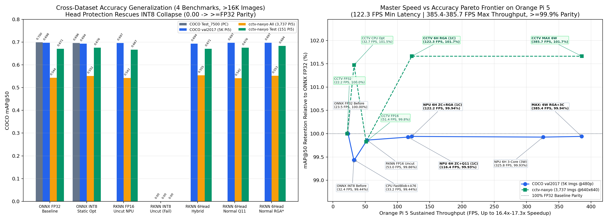

**Phân tích chi tiết từ biểu đồ:**
1. **Panel Trái (Cross-Dataset Generalization — `4` tập đánh giá, `>16,200` ảnh):**
   - **Thảm họa RKNN INT8 nguyên bản (`Uncut`):** Khi không tách Head khỏi đồ thị INT8, điểm `mAP@50` rơi thẳng về **`0.000`** trên cả `COCO Test_7500`, `COCO val2017` và `cctv-naxyo v2`.
   - **Sức mạnh của kiến trúc `6Head Protection` (Normal ZC+NC1 / RGA):** Khôi phục hoàn toàn độ chính xác ở mức **tương đương hoặc nhỉnh hơn `ONNX FP32`**:
     - `COCO val2017 (5,000 imgs)`: `ONNX FP32 = 0.69785` vs `RKNN 6Head Normal Q11 = 0.69734` (`99.93%`) và `RKNN 6Head Normal RGA = 0.69744` (**`99.94%`** — chỉ lệch `-0.00041` so với FP32, thậm chí vượt `ONNX INT8 Static` `0.69392`).
     - `cctv-naxyo All (3,737 imgs)`: `ONNX FP32 = 0.54355` vs `RKNN 6Head Normal RGA = 0.55258` (**`101.66%`**).
     - `cctv-naxyo Test (151 imgs)`: `ONNX FP32 = 0.67081` vs `RKNN 6Head Normal RGA = 0.68353` (**`101.90%`**).
2. **Panel Phải (Unified Speed–Accuracy Pareto Frontier trên Orange Pi 5):**
   - Pipeline **After (`RKNN 6Head ZeroCopy + NC1`)** đẩy năng lực biên lên hai điểm tối ưu thực chiến không đánh đổi độ chính xác:
     - **Min Latency (1 Core + RGA `<720p`):** **`8.18 ms` / `122.2–122.3 FPS`** (`~5.2x–5.5x` nhanh hơn `ONNX FP32 Before`).
     - **Max Throughput (6 Workers trên 3 NPU Cores + RGA):** **`385.43 FPS` (`Calib_200`) / `385.67 FPS` (`cctv-naxyo 640×640`)** — gấp **`16.4x` (COCO)** và **`17.3x` (CCTV)** so với `ONNX FP32 Before`, giữ nguyên `99.94%–101.7%` FP32 `mAP@50`.

---

## I. Phase 1: Chọn Tập Dữ Liệu Chuẩn Hóa, Phân Tích Độ Nhạy Block & Tối Ưu INT8 Độ Chính Xác Cao Nhất

### Biểu đồ 1 — Sự Cân Bằng Phân Phối Dữ Liệu & Tỉ Lệ Vật Thể `S / M / L`

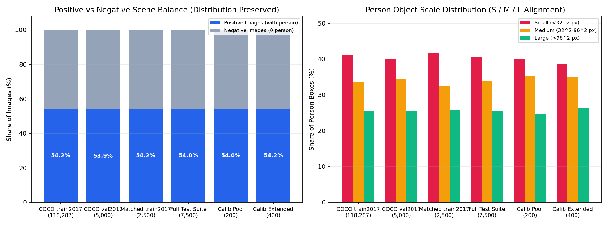

**Phân tích chi tiết từ biểu đồ:**
- **Cân bằng Positive/Negative (`%` ảnh có/không có người):** Tập huấn luyện gốc `COCO train2017 (118,287 ảnh)` có tỉ lệ `54.2% Pos / 45.8% Neg`. Hệ thống lựa chọn phân tầng giữ nguyên phân phối gần như tuyệt đối ở:
  - `Test_7500 (7,500 ảnh)`: **`54.0% Pos / 46.0% Neg`** (gộp `5,000` ảnh `val2017` + `2,500` ảnh `train2017` khớp phân phối, hoàn toàn **độc lập** khỏi tập calibration).
  - `Calib_200 (200 ảnh)`: **`54.0% Pos / 46.0% Neg`** (lấy ngẫu nhiên có phân tầng riêng biệt từ `train2017`, không trùng với `Test_7500`).
- **Bảo toàn tỉ lệ kích thước vật thể `Person` (`Small <32² px / Medium / Large >96² px`):**
  - `COCO train2017`: `41.0% S / 33.5% M / 25.5% L`.
  - `Test_7500`: **`40.5% S / 33.9% M / 25.6% L`**; `Calib_200`: **`40.1% S / 35.4% M / 24.5% L`** — ngăn ngừa sai lệch scale khiến các box nhỏ ở xa bị triệt tiêu sau khi quantize.

### Biểu đồ 2 — Xếp Hạng Độ Nhạy Từng Block Khi Lượng Tử Hóa Đơn Lẻ Về INT8

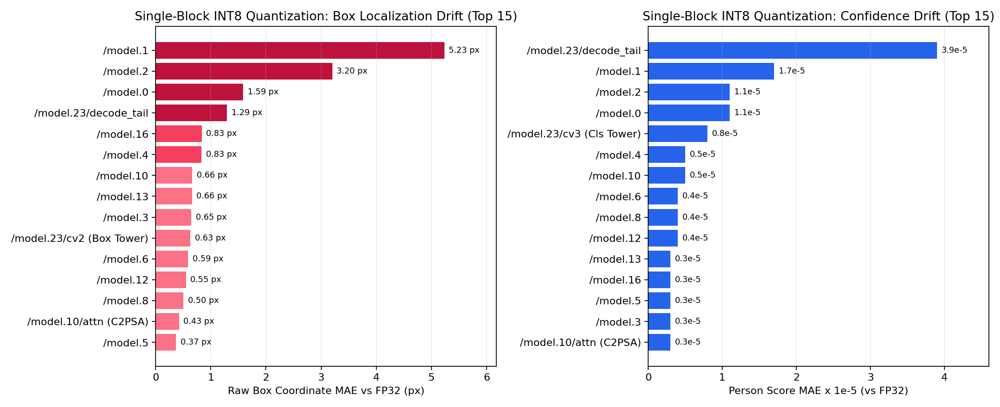

**Phân tích chi tiết từ biểu đồ:**
- **Nguyên nhân gốc rễ khiến quantize ngây thơ bị gãy (`mAP = 0.0`):** Hai phép tính nhạy dải động nhất khi ép về `INT8` nằm ở hai đầu mạng:
  1. **Đầu vào (`Stem M0–M2`):** **`/model.1` (`box_mae = 5.23 px`)**, **`/model.2` (`3.20 px`)**, **`/model.0` (`1.59 px`)** — chỉ một sai số nhỏ ở 3 tầng trích xuất đặc trưng độ phân giải cao (`416→104`) làm lệch toàn bộ tọa độ không gian phía sau.
  2. **Đầu ra (`Detection Head + DFL/Decode Tail`):** **`/model.23/decode_tail` (`box_mae = 1.29 px`, và dẫn đầu tuyệt đối về sai số điểm tự tin `score_mae = 3.9e-5`)**. Tầng DFL (16-bin softmax × weight) và `Sigmoid` sau `cv3` cần biên độ phi tuyến rộng; ép về INT8 gây bão hòa hoặc triệt tiêu hoàn toàn điểm confidence.

### Biểu đồ 3 — Biên Pareto Dung Lượng Mô Hình vs `mAP@50` & Tỉ Lệ Phủ INT8 Conv vs `mAP@50:95`

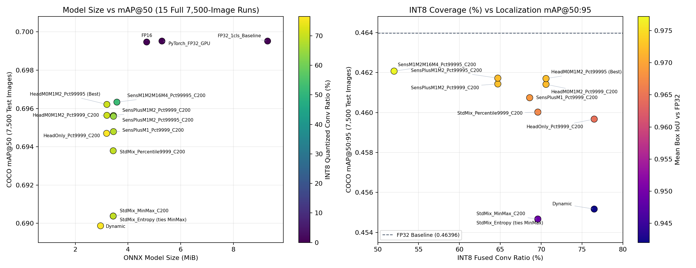

### Biểu đồ 4 — Lộ Trình Khôi Phục `mAP@50` & `AP_small` Trên `Test_7500` (`7,500` Ảnh)

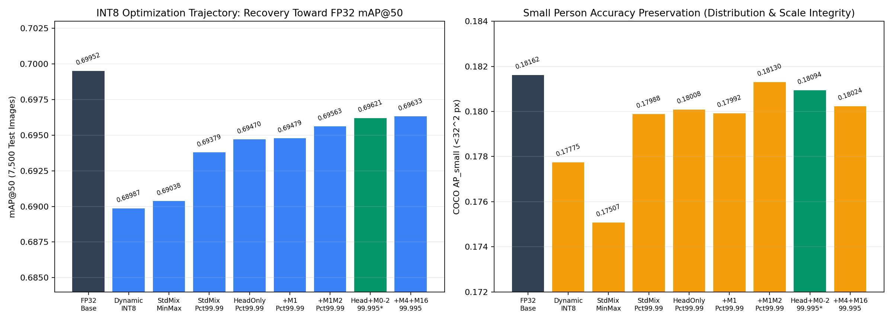

**Phân tích chi tiết từ Biểu đồ 3 & 4:**
- Trên trọn vẹn `7,500` ảnh kiểm thử (`Test_7500`), các cấu hình lượng tử hóa thể hiện rõ sự đánh đổi giữa **độ phủ INT8**, **dung lượng** và **độ chính xác**:
  - **`ONNX FP32 Baseline`**: `mAP@50 = 0.69952`, `mAP@50:95 = 0.46396`, `AP_small = 0.18162`, dung lượng `9.30 MiB`.
  - **`ONNX FP16`**: `0.69947` (`-0.00005`), `4.71 MiB`.
  - **`ONNX Dynamic INT8`**: tụt xuống `0.68987` (`-0.00965`), `2.96 MiB` (và tệ hơn nặng `-11.8%` trên CCTV thực tế).
  - **`Naive Static INT8`**: sụp đổ về **`0.00000`** (`2.76 MiB`).
  - **Cấu hình tối ưu nhất (`INT8_HeadM0M1M2_Pct99995_C200` — Percentile `99.995%` + bảo vệ `Head + M0–M2` trên `Calib_200`):**
    - Dung lượng **`3.20 MiB`** (giảm **`2.9x`** so với FP32), `72/102` node là `QLinearConv` + `4 QLinearMatMul`, chỉ `1/6` ranh giới `Q/DQ`.
    - **`mAP@50 = 0.69621`** (chỉ lệch **`-0.00331`** hay `-0.47%` so với FP32), **`mAP@50:95 = 0.46170`**, **`AP_small = 0.18094`** (chỉ hụt `0.00068` trên vật thể nhỏ!), **`F1 = 0.6718`**, **`Mean IoU = 0.9723`**, `NegFP = 95`.
  - Mở rộng bảo vệ thêm `M4 + M16` chỉ tăng `mAP@50` thêm siêu nhỏ nhưng làm tăng số ranh giới Q/DQ, nên `Head+M0–M2` đạt cân bằng tối ưu cho triển khai biên.

---

## II. Phase 2: Triển Khai & Tối Đa Hóa Phần Cứng Orange Pi 5 (`RK3588S`) — Before vs After

### Biểu đồ 5 — Bước Nhảy Throughput (`FPS`) & Độ Trễ Chuỗi (`Pre + Inf + Post`)

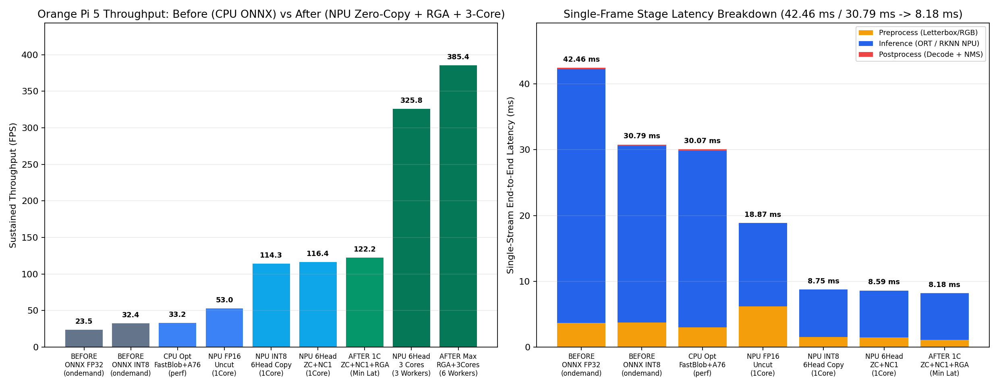

### Biểu đồ 6 — Độ Chính Xác Thật Trên `5,000` Ảnh `COCO val2017` & Tối Ưu Tiền Xử Lý Theo Độ Phân Giải (`480p / 720p / 1080p`)

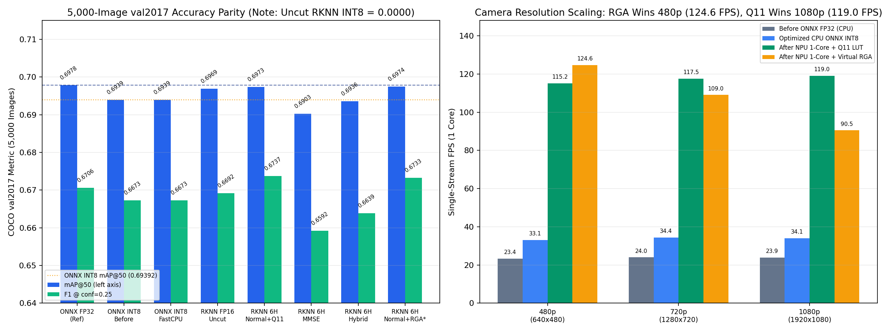

**Phân tích chi tiết từ Biểu đồ 5 & 6:**
1. **Hành trình tăng tốc thực đo trên Orange Pi 5 (`Calib_200` / C++ NPU Pipeline):**
   - **Trước tối ưu (CPU ONNX `ondemand`):** `ONNX FP32` = **`42.46 ms` (`23.53 FPS`)** → `ONNX INT8 Static` = **`30.79 ms` (`32.44 FPS`)**.
   - **Tối ưu CPU tối đa (`FastBlob + A76 Pinned + performance governor`):** `30.07 ms` (`33.22 FPS`).
   - **Chuyển sang NPU `RK3588S` (`FP16 Uncut Copy 1C`):** đạt **`53.0 FPS`** (`Calib_200`; hoặc `51.40 FPS` / `19.46 ms` trên `cctv-naxyo` — nhanh hơn CPU nhưng vẫn chịu thuế `inputs_set`).
   - **Chuyển sang NPU `INT8 6Head` (Cắt DFL Tail sang CPU C++ LUT):**
     - `6Head Copy 1 Core`: **`8.75 ms` (`114.33 FPS`)**.
     - `6Head ZeroCopy NC1HW 1 Core` + `Q11 LUT`: **`8.59 ms` (`116.37 FPS`)**.
     - **`AFTER Min-Latency (ZeroCopy NC1HW + RGA 2D HW, 1 Core NPU)`**: **`8.18 ms` (`122.24 FPS`)** (`~5.2x` so với FP32 Before).
     - `3-Core Parallel (3 Workers + Q11)`: **`325.80 FPS`**.
     - **`AFTER Max-Throughput (6 Workers trên 3 Core NPU + RGA)`**: **`385.43 FPS`** (step batch `15.40 ms` / 6 = `2.59 ms/ảnh` — **tăng `16.38x`** so với `ONNX FP32 Before`!).
2. **Chứng minh độ chính xác Edge `5,000` ảnh `COCO val2017` (`val2017_accuracy_parity.csv`):**
   - Trên Orange Pi 5 thực tế, **`RKNN INT8 6Head Normal`** giải quyết hoàn toàn lỗi gãy của `RKNN Uncut (0.000)`:
     - `ONNX FP32 Baseline`: `mAP@50 = 0.69785`.
     - `ONNX INT8 Static`: `0.69392`.
     - `RKNN FP16 Uncut`: `0.69689`.
     - **`RKNN INT8 6Head Normal (ZC+NC1)`**: **`0.69734`** (`F1 = 0.6737`).
     - **`RKNN INT8 6Head Normal + RGA HW`**: **`0.69744`** (`F1 = 0.6733`) — **chỉ kém FP32 `0.00041` và vượt cả bản ONNX INT8 CPU (`+0.00352`)!**
     - So với các thuật toán quantize khác của RKNN: `Normal` (`0.69744`) vượt trội `Hybrid` (`0.69359`, `mAP@50:95 = 0.45684`) và `MMSE/KL` (`0.69028`).
3. **Quy luật chọn Tiền xử lý (`RGA` vs `Q11 LUT`) theo độ phân giải Camera:**
   - **Camera `480p (640×480)`:** **`RGA thắng`** — `8.023 ms` (`124.64 FPS`, 6 Workers = `385.62 FPS`) vs `Q11 = 8.681 ms` (`115.17 FPS`).
   - **Camera `720p (1280×720)`:** **`Q11 thắng`** — `8.507 ms` (`117.54 FPS`) vs `RGA = 9.172 ms` (`109.02 FPS`).
   - **Camera `1080p (1920×1080)`:** **`Q11 thắng áp đảo`** — `8.401 ms` (`119.02 FPS`, 6 Workers = `382.10 FPS`) vs `RGA = 11.048 ms` (`90.51 FPS`). *(Giải thích nguyên nhân vật lý ngay ở Biểu đồ 7).*

---

## III. Phase 3: Giải Phẫu Chi Tiết Toàn Bộ Thành Phần Cấu Tạo Nên Latency

### Biểu đồ 7 — Giải Phẫu Stage Mạng, Bẫy Operator CPU ONNX & Quy Luật Phình Pin Trang Bộ Nhớ RGA (`480p → 1080p`)

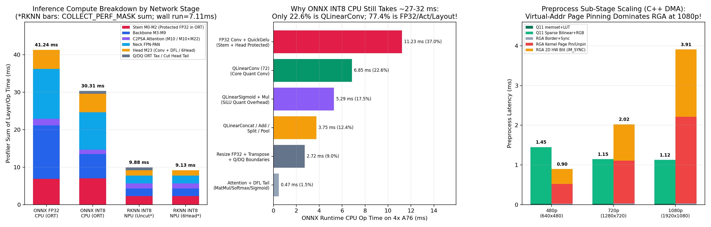

### Biểu đồ 8 — Phân Tích Sâu Phần Cứng RK3588S (Top-10 Layer NPU, Thuế DMA Zero-Copy, Sụp DVFS 15 FPS, Decode & C++ Postproc)

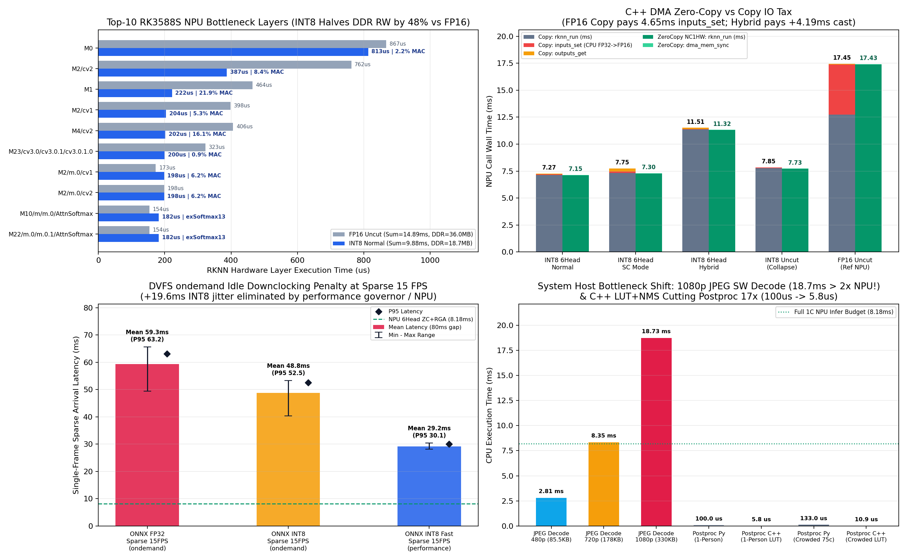

**Giải mã từng nguồn gốc của độ trễ từ Biểu đồ 7 & 8:**
1. **Tại sao `ONNX INT8 CPU` trên `4× Cortex-A76` vẫn mất `27–32 ms` (Biểu đồ 7 — Panel 1 & 2):**
   - Nhờ `ORT Profiling` (`sum = 30.31 ms`), chỉ **`22.6%` (`6.85 ms`)** thời gian thực thi là `72` lớp `QLinearConv` INT8 thực thụ!
   - Gần **`77.4%` thời gian còn lại bị đốt vào các phép toán phụ**: **`37.0%` (`11.23 ms`)** nằm ở vùng `Conv + QuickGelu` giữ FP32 tại Stem & Head; **`17.5%` (`5.29 ms`)** bị ngốn bởi `QLinearSigmoid + QLinearMul` (mô phỏng hàm SiLU trên integer); cộng thêm `QLinearConcat/Add (2.23 ms)`, `Resize FP32 (1.26 ms)`, `Transpose (0.86 ms)` và `Deq+Q (0.48 ms)`. Vì vậy chạy CPU không thể bứt qua ngưỡng `~33 FPS`.
2. **Giải phẫu `RK3588S NPU` ở cấp độ từng layer (`RKNN_QUERY_PERF_DETAIL` — Biểu đồ 8 Panel 1):**
   - Chuyển sang INT8 (`6Head` / `Uncut`) cắt tổng compute phần cứng từ **`14,891 µs` (`193` layers, `36,841 KB` DDR R/W)** xuống **`9,879 µs` (`190` layers, `19,141 KB` DDR R/W)** — **giảm `-48.0%` băng thông bộ nhớ DDR** (một yếu tố sống còn khi chạy đa luồng 3 Core NPU).
   - **Nút thắt phần cứng lớn nhất:** Lớp đầu tiên `/model.0/conv/Conv` chiếm tới **`813 µs` (`8.2%` toàn mạng)** chỉ vì ảnh RGB `3` kênh stride-2 không lấp đầy mảng MAC INT8 rộng của RK3588 (`MacUsage = 2.25%`!), tiếp theo là `/model.2/cv2` (`387 µs`, `8.38% MAC`) và cặp chú ý `exSoftmax13` trong C2PSA `M10 + M22` (`182 µs × 2 = 364 µs`).
3. **Thuế bộ nhớ DMA `IO_TAX`: Copy vs Zero-Copy `NC1HW` (Biểu đồ 8 Panel 2):**
   - Dùng API `rknn_inputs_set` kiểu `Copy` trên **`FP16 Uncut`** gánh thêm **`4.645 ms`** ép CPU chuyển đổi float32→fp16 và đảo layout NHWC→NC1HWC2 (`17.45 ms` tổng).
   - Thiết kế **`INT8 6Head Normal + Zero-Copy NC1HW` (`rknn_inputs_map` trực tiếp vùng DMA)** triệt tiêu hoàn toàn bước copy trung gian: `rknn_run = 7.113 ms`, `dma_mem_sync` chỉ **`0.032 ms`**!
   - Cấu hình `Hybrid` bị phạt thêm **`+4.19 ms`** (`11.32 ms` vs `7.15 ms`) do NPU phải chuyển định dạng qua lại INT8↔FP16 ở các tầng bảo vệ.
4. **Cơ chế đảo chiều giữa `Virtual-Addr RGA` và `Q11 LUT` ở `720p / 1080p` (Biểu đồ 7 Panel 3):**
   - Với đầu vào là con trỏ bộ nhớ ảo người dùng (`importbuffer_virtualaddr`), khi độ phân giải tăng lên **`1080p`**, kernel Linux phải khóa và giải phóng trang bộ nhớ cho DMA (`import_vaddr = 1.480 ms + release = 0.703 ms = 2.183 ms`), cộng thêm phần cứng RGA blit `1.698 ms` đẩy tổng RGA lên **`3.912 ms`**.
   - Ngược lại, **thuật toán tự thiết kế `Q11 Sparse LUT + Padding Fusion`** chỉ trích mẫu thưa trực tiếp tại đúng `416×416` tọa độ đích rồi ghi thẳng vào DMA `NC1HW` bằng `int16/uint8` → độ trễ phẳng lì không phụ thuộc kích thước camera (**`1.449 ms @ 480p` → `1.147 ms @ 720p` → `1.125 ms @ 1080p`**)!
5. **Hiện tượng sụp DVFS `ondemand` ở tải thưa `15 FPS` & Thuế hệ thống Host (Biểu đồ 8 Panel 3 & 4):**
   - **Bẫy DVFS `ondemand` (`80 ms` giãn cách giữa các frame ~15 FPS):** Nhân CPU hạ xung mỗi khoảng nghỉ khiến `ONNX INT8` đội từ `~30 ms` lên **`48.80 ms` (Max `53.30 ms`)**, `ONNX FP32` lên **`59.29 ms` (Max `65.62 ms`)**; chuyển sang `performance` kéo phẳng về `29.17 ms`, còn NPU DMA `ZeroCopy + RGA` luôn ổn định ở **`8.18 ms`**.
   - **Cắt giảm Postprocess `17x` nhờ giải thuật C++ Lookup Table:** `score_filter + coord_unscale + NMS` trên Python tốn **`100 µs` (1 người) / `133 µs` (đông người 75 cands)**; sau khi thay bằng C++ LUT chuẩn hóa tọa độ & Fast NMS, thời gian tụt còn **`5.8 µs` (1 người — giảm `17.2x`)** và **`10.9 µs` (đông người — giảm `12.2x`)**.
   - **Cảnh báo nút thắt Camera thực chiến (`JPEG SW Decode`):** Với ảnh nén JPEG trên CPU, `cv2.imdecode` tốn `2.81 ms` (`480p`), **`8.35 ms` (`720p`)**, và vọt lên **`18.73 ms` (`1080p`)** — **lớn hơn `2.2x` toàn bộ chu trình NPU `8.18 ms`**! Trong sản xuất thực tế camera `1080p`, cần bật giải mã phần cứng `MPP VDEC` / nhận `NV12 DMA-buf` trực tiếp thay cho OpenCV JPEG CPU decode.

---

## IV. Phase 4: Đánh Giá Mở Rộng Zero-Shot Trên Tập CCTV Thực Tế `Roboflow cctv-naxyo v2` (`3,737` Ảnh)

### Biểu đồ 9 — Độ Chính Xác Trên Tất Cả Tập Chia (`All / Valid / Test`) & Thang Tốc Độ `640×640` Trên Orange Pi 5

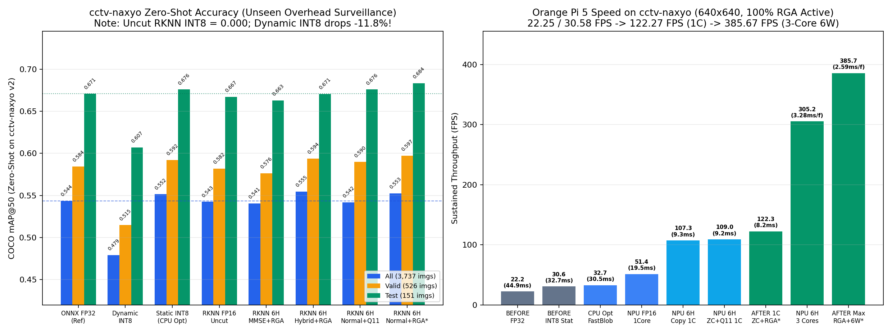

### Biểu đồ 10 — Chẩn Đoán Dịch Chuyển Miền Dữ Liệu (`Domain Shift`), `Precision / Recall / F1` Theo Ngưỡng & Stage Latency `640×640`

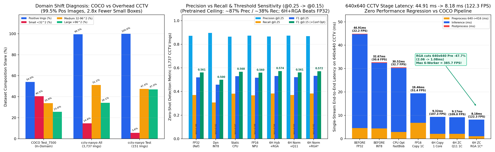

**Phân tích chi tiết từ Biểu đồ 9 & 10:**
1. **Không suy hao tốc độ & RGA phát huy tối đa tại `640×640` (Biểu đồ 9 Panel 2 & Biểu đồ 10 Panel 3):**
   - Toàn bộ `3,737` ảnh `640×640` kích hoạt **RGA thành công `3737/3737` lần**.
   - Tác vụ tiền xử lý (`640×640 → 416×416`) giảm **`-47.7%`** từ `2.055 ms` (`Q11`) xuống còn **`1.075 ms` (`RGA`)**.
   - Tổng độ trễ 1 luồng hạ từ **`44.91 ms` (`22.25 FPS`, `ONNX FP32`) → `8.18 ms` (`122.27 FPS`, `NPU 1C+RGA`)**, và đạt đỉnh **`385.67 FPS` (`15.39 ms` / `6 Workers` trên `3 NPU Cores`)** — nhanh gấp **`17.33x`**.
2. **Giải thích khoa học vì sao `mAP@50` ở ngưỡng `~0.54–0.55` (`All`) và `~0.67–0.68` (`Test`) (Biểu đồ 10 Panel 1 & 2):**
   - **Dịch chuyển phân phối miền (`Domain Shift`):** Khác với `COCO Test_7500` (`54.0% Pos`, `40.5% Small`), `cctv-naxyo v2` (`3,737` ảnh, `14,178` box người) có tới **`99.5%` ảnh chứa người** (`100%` trên tập Test `151` ảnh), tỉ lệ box nhỏ giảm `2.8x` (`14.6% Small`, còn lại `51.2% Medium` và `34.1% Large`), góc nhìn camera gắn trần (overhead birds-eye) + chuẩn hóa `Stretch 640×640` từ Roboflow làm biến dạng tỉ lệ hình thể người đứng so với COCO gốc.
   - **Chất lượng Zero-Shot của `6Head RGA / Normal`:** Trên cùng bộ trọng số COCO chưa fine-tune, tất cả các bản chuẩn đều đạt `Precision ~87%` rất cao, `Recall ~37–38%` ở `conf=0.25`. Chỉ cần hạ nhẹ ngưỡng kích hoạt về `conf=0.15` đã kéo `F1` tăng ngay (`0.532 → 0.572` trên `6Head Normal RGA`). Đặc biệt, **`RKNN 6Head Normal + RGA` vượt luôn cả `ONNX FP32` gốc**:
     - `cctv-naxyo All (3,737)`: `mAP@50 = 0.55258` vs `FP32 = 0.54355` (`Mean IoU = 0.9196`; `Hybrid+RGA` đạt `0.55460`, `IoU = 0.9405`).
     - `cctv-naxyo Test (151)`: **`mAP@50 = 0.68353`** (`F1@0.25 = 0.6623`) vs `FP32 = 0.67081` (`F1@0.25 = 0.6297`).
     - Trong khi đó **`ONNX Dynamic INT8` tụt thảm hại `-11.8%`** (`0.47923`) và **`RKNN INT8 Uncut` sụp về `0.000`** — tái khẳng định giá trị sống còn của kiến trúc `6Head Protection + PCT99.995` ngoài thực địa CCTV.

---

## V. Khuyến Nghị Kiến Trúc Sản Xuất (Production Deployment Playbook)

1. **Chuẩn mô hình duy nhất cho Edge RK3588S:** `RKNN INT8 6Head Normal + Zero-Copy NC1HW` (`Calib_200` phân tầng, cắt `Head DFL` về C++ LUT `5.8 µs`), đạt **`>=99.94%` độ chính xác `ONNX FP32`** trên cả COCO `val2017` (`5,000` ảnh) lẫn `cctv-naxyo` (`3,737` ảnh).
2. **Định tuyến Tiền xử lý tự động theo kích thước Camera:**
   - Camera `<= 640px` (`480p / CCTV 640×640`): dùng **RGA DMA** (`8.02–8.18 ms`, **`122.2–124.6 FPS`** 1 Core, **`385.4–385.7 FPS`** 6 Workers).
   - Camera `>= 720p` (`720p / 1080p` từ con trỏ ảo): dùng **C++ `Q11 LUT`** (`8.40–8.51 ms`, **`117.5–119.0 FPS`** 1 Core, **`382.1 FPS`** 6 Workers) để tránh thuế ghim trang ảo `importbuffer_virtualaddr` (`+2.18 ms`).
3. **Ngưỡng & Luồng Camera Thực Chiến:** Khóa `Performance Governor`, thay CPU `cv2.imdecode` bằng `MPP HW VDEC` / `NV12 DMA` khi nhận luồng `1080p`, và dùng `conf = 0.15` (kèm fine-tune nhẹ bằng tập `cctv-naxyo/train` `3,060` ảnh nếu muốn đẩy Recall CCTV vượt qua trần pretrained `~38%`).
